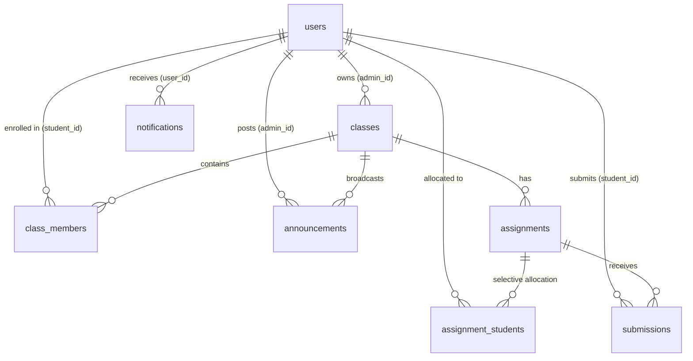

# Assignora — Assign. Track. Achieve.

> **Production-Quality Educational Assignment & Academic Workflow Management Platform**  
> *A modern, role-isolated SaaS for professors, instructors, administrators, and students.*

---

## 📖 1. Project Overview & Purpose

**Assignora** is an intuitive, modern academic workflow and learning management platform engineered to streamline coursework allocation, student submissions, evaluation, and classroom communication. Drawing inspiration from Google Classroom and modern SaaS productivity dashboards, Assignora delivers a purple-gradient design system with high usability, responsive layouts, and strict data security.

The platform provides strictly separated, role-based workflows:
- **Admin / Teacher**: Complete class lifecycle management, flexible assignment creation (whole-class or selective student allocations), deadlines and points configuration, real-time submission tracking, student-wise status grids, gradebook evaluation with constructive feedback, and CSV data export.
- **Student**: Coursework dashboard, enrolled class streams, actionable assignment feeds, two-step submission confirmation workflow with deliverable link validation, celebratory completion feedback, duplicate submission guards, and personal progress analytics.

---

## 🎯 2. Problem Statement & Project Objectives

### The Problem
Traditional educational institutions and courses frequently suffer from fragmented coursework processes:
- **Scattered Submissions**: Deliverables shared across unorganized email chains, WhatsApp groups, or direct messages, causing missed deadlines and lost files.
- **Lack of Real-Time Visibility**: Students lack a consolidated, clear picture of upcoming vs. overdue deadlines and personal completion rates.
- **Grading Overhead**: Instructors spend excessive time reconciling spreadsheets, tracking late submissions manually, and distributing feedback individually.
- **Disjointed Learning Resources**: Textbooks, lecture notes, and templates are distributed in silos rather than integrated directly into course streams.

### Project Objectives
1. **Centralize Assignment Workflows**: Create a single hub for course creation, assignment distribution, deliverable submission, and grading.
2. **Ensure Data Integrity & Security**: Protect academic records through Postgres Row Level Security (RLS) and verified role-based access control.
3. **Enhance Student Motivation**: Provide clear visual feedback through radial progress indicators, instant status badges, and two-step celebratory submission confirmation.
4. **Foster Academic Communication**: Facilitate contextual class announcements, interactive discussion streams, and real-time WhatsApp-style unread notification counters.
5. **Promote Open Education**: Integrate authentic Open Educational Resources (OER) directly into subject course views.

---

## 🎨 3. Design System & Tokens

Assignora adheres to a purple-gradient design system with accessible contrast and responsive geometry:

| Token Name | Hex Code | Visual Application |
| :--- | :--- | :--- |
| **Primary Purple** | `#5B21F6` | Primary action buttons, active tab indicators, brand accents |
| **Primary Hover** | `#4C1D95` | Button hover and pressed states |
| **Secondary Purple** | `#8B5CF6` | Sub-headers, secondary badges, illustrations |
| **Light Purple** | `#EDE9FE` | Subtle container backgrounds, avatar rings |
| **Active Navigation** | `#F1EDFF` | Active sidebar navigation pill background |
| **Purple Border** | `#DDD6FE` | Accent card borders |
| **App Canvas** | `#F8F9FF` | Main application background |
| **Secondary Canvas** | `#F5F3FF` | Card gradients and secondary sections |
| **Surface White** | `#FFFFFF` | Cards, sidebars, modals, headers |
| **Headings** | `#111827` | Primary high-contrast text |
| **Body** | `#374151` | Standard readable paragraph text |
| **Muted** | `#64748B` | Labels, timestamps, placeholders |
| **Success** | `#16A34A` | Submitted badges, on-time submissions, positive progress |
| **Warning** | `#F59E0B` | Pending submissions, due soon badges, late submissions |
| **Danger** | `#EF4444` | Overdue deadlines, unsubmitted alerts |

- **Typography**: Inter (Headings: 600–700 font-weight, Body: 400, Buttons: 500–600).
- **Geometry**: Cards: `14px` border radius (`rounded-card`), Form inputs & buttons: `9px` radius, subtle shadows (`0 1px 3px rgba(0,0,0,0.05)`).

---

## ✨ 4. Main Features & Roles

### 🔐 Authentication & Session Security
- **Email & Password Authentication**: Powered by Supabase Auth (GoTrue).
- **Verified Role Resolution**: Role state (`admin` vs `student`) is queried directly from `public.users` in Postgres upon GoTrue authentication, preventing client-side privilege escalation.
- **Role-Guarded Routing**: Separate route guards (`/admin/*` vs `/student/*`) with automatic redirect handling.
- **Session Persistence**: Automatic token refresh and session persistence via browser local storage.

### 👩‍🏫 Admin / Teacher Workspace
- **Executive Dashboard**: Welcome banner, live metric cards (*Classes, Assignments, Submissions, Avg. Completion Rate*), and upcoming assignment timeline.
- **Class Management**:
  - Grid view of active classes with distinct gradient banners and student count badges.
  - Dedicated Class Page with 5 tabs: **Overview**, **Assignments**, **People**, **Messages**, and **Resources**.
  - Two-method student enrolment: unique 6-character class code lookup and direct student invitation modal.
- **Assignment Creation & Control**:
  - Modal with title, rich description, points weighting, due date and time pickers.
  - Google Drive / resource URL attachment.
  - Allocation targeting: **Assign to All Class Members** or **Select Specific Students**.
- **Submission Tracking & Evaluation**:
  - Detailed submission tracking table filtering by status (*Submitted, Graded, Pending, Late*).
  - Inspect student deliverable links (Google Drive, GitHub, PDF) and student notes.
  - In-place grading modal: enter marks, compute dynamic letter grades (`A+` to `F`), and save constructive teacher feedback.
  - Real-time completion progress bar `(Submitted / Assigned) × 100`.
  - One-click **CSV Data Export** of class submissions.
- **People Page & Roster**:
  - Tabular roster of enrolled students with avatars, student IDs, emails, and enrolment dates.
  - Student profile viewer modal.
  - Safe student removal with confirmation safeguard.

### 👨‍🎓 Student Workspace
- **Coursework Dashboard**:
  - Academic greeting banner with personalized stats (*Total Assigned, Submitted, Pending, Overall Completion Rate*).
  - SVG radial donut chart illustrating personal coursework completion breakdown.
  - Grid of enrolled classes with direct links to class streams.
- **Assignments Feed**:
  - Comprehensive list of assigned coursework grouped by deadline urgency.
  - Direct access to teacher resources and submission modal.
- **Two-Step Submission Flow**:
  1. *Step 1*: Attach deliverable URL (Drive/Docs/GitHub) and add student commentary.
  2. *Step 2*: Final submission confirmation dialog preventing accidental submissions.
  3. *Celebratory Completion*: Triggers confetti animation (`canvas-confetti`) and immediately transitions status to *Submitted*.
- **Duplicate Submission Guard**: Hard prevention both in the UI and enforced by a database unique constraint on `(assignment_id, student_id)`.
- **Grade & Feedback Inspection**: Students view awarded marks, letter grades, and qualitative instructor feedback directly inside the assignment details view.

### 📢 Announcements, Discussions & Real-Time Badges
- **Formal Announcements**: Instructors post class-wide announcements broadcast to all enrolled students.
- **Class Discussion Stream**: Dedicated interactive chat stream for peer and teacher inquiries.
- **WhatsApp-Style Notifications**:
  - Red notification badge on the sidebar bell icon displaying unread notification count (`1`, `5`, `12`, `99+`).
  - Per-class unread counters indicating new messages in the class list.
  - Dynamic Supabase Realtime channel integration with clean subscription teardown.

### 📚 Open Educational Resources (OER)
Integrated subject-specific curated academic resources in each class:
- **OpenStax**: Peer-reviewed, open-source textbooks.
- **MIT OpenCourseWare**: Lecture notes and syllabus frameworks.
- **Open Textbook Library**: Supplementary academic reading.
- **Google Docs / Sheets**: Practical analysis models, rubrics, and project templates.
- **DOAB (Directory of Open Access Books)**: Peer-reviewed academic monographs.

---

## 🛠️ 5. Technology Stack

| Layer | Technology | Purpose |
| :--- | :--- | :--- |
| **Frontend Framework** | React 18 | Declarative component-driven user interface |
| **Bundler & Dev Server**| Vite 6 | Rapid Hot Module Replacement (HMR) and optimized Rollup production builds |
| **Styling** | Tailwind CSS 3 & PostCSS | Utility-first responsive design tokens |
| **Routing** | React Router DOM 6 | Single-page application nested client routing with route guards |
| **Database & Auth** | Supabase (PostgreSQL 15) | Relational database, GoTrue Auth, Realtime engine, and Row Level Security |
| **Icons** | Lucide React | Modern SVG icon system |
| **Visual Effects** | Canvas Confetti | Celebratory feedback for student submissions |

---

## 🗄️ 6. Database Architecture & Schema

The platform connects to Supabase PostgreSQL with 8 relational tables protected by Row Level Security (RLS):



### Table Definitions

| Table | Primary Key | Key Columns | Purpose |
| :--- | :--- | :--- | :--- |
| `users` | `id` (uuid) | `name`, `email`, `role`, `avatar`, `student_id`, `created_at` | User profiles with role flags (`admin` \| `student`) |
| `classes` | `id` (uuid) | `name`, `subject`, `description`, `admin_id`, `created_at` | Course and classroom entities |
| `class_members` | `id` (uuid) | `class_id`, `student_id`, `joined_at` | Student classroom enrolment registry |
| `assignments` | `id` (uuid) | `title`, `description`, `class_id`, `admin_id`, `due_date`, `due_time`, `points`, `drive_link`, `assign_to_all`, `status` | Coursework allocations and deadlines |
| `assignment_students` | `id` (uuid) | `assignment_id`, `student_id`, `assigned_at` | Targeted student assignment allocation mapping |
| `submissions` | `id` (uuid) | `assignment_id`, `student_id`, `submission_link`, `comment`, `status`, `submitted_at`, `updated_at` | Student deliverable records with unique `(assignment_id, student_id)` constraint |
| `announcements` | `id` (uuid) | `title`, `message`, `admin_id`, `class_id`, `is_published`, `created_at` | Class announcements and discussion threads |
| `notifications` | `id` (uuid) | `user_id`, `title`, `message`, `type`, `reference_id`, `is_read`, `created_at` | User notification events with read tracking |

### Row Level Security (RLS) Highlights
- **Assignment Privacy**: Students can only query assignments allocated to their enrolled classes or assigned to them individually.
- **Submission Confidentiality**: Students can only insert and read their own submissions. Instructors can inspect and update submissions for assignments in their owned classes.
- **Roster Protection**: Enrolment queries verify active class membership before granting student access.

---

## 📁 7. Project Folder Structure

```
assignora/
├── .env.example                     # Environment configuration template
├── .gitignore                       # Git ignore specifications
├── index.html                       # Application entry HTML document
├── package.json                     # NPM dependencies and scripts
├── postcss.config.js                # PostCSS processor configuration
├── tailwind.config.js               # Tailwind design tokens and theme extensions
├── vercel.json                      # Vercel SPA routing configuration
├── vite.config.js                   # Vite bundler and code-splitting rules
├── scripts/                         # Database population and testing utilities
│   ├── seed-academic-demo-data.js   # Class, assignment, and discussion seeder
│   └── seed-submissions.js          # Realistic submission and grading seeder
└── src/
    ├── App.jsx                      # Main application component & providers
    ├── main.jsx                     # React DOM root entry
    ├── index.css                    # Tailwind utility and global CSS rules
    ├── components/
    │   ├── admin/                   # Admin modals (StudentSelectionModal)
    │   ├── class/                   # Class modals (InviteStudent, JoinClass, StudentProfile)
    │   ├── common/                  # Reusable UI atoms (Button, Card, Badge, Modal, Input, etc.)
    │   ├── layout/                  # Shared shell (DashboardLayout, Header, Sidebar, MobileNav)
    │   └── student/                 # Student modals (TwoStepSubmissionModal)
    ├── context/
    │   ├── AuthContext.jsx          # GoTrue authentication and profile state
    │   └── NotificationContext.jsx  # Unread badge counters and Realtime subscription
    ├── hooks/
    │   └── useAuth.js               # Authentication convenience hook
    ├── lib/
    │   └── supabase.js              # Supabase client instantiation & URL sanitization
    ├── pages/
    │   ├── Login.jsx                # Universal authentication page
    │   ├── admin/                   # Admin views (Dashboard, Classes, Assignments, Grading)
    │   ├── shared/                  # Shared views (ClassDetail, Profile, Settings, JoinClass)
    │   └── student/                 # Student views (Dashboard, AssignmentDetails, Submissions)
    ├── routes/
    │   ├── AppRoutes.jsx            # Application route definitions
    │   ├── ProtectedRoute.jsx       # Authentication guard
    │   └── RoleRoute.jsx            # Role verification guard (`admin` vs `student`)
    ├── services/                    # Database and API services
    │   ├── announcements.service.js
    │   ├── assignments.service.js
    │   ├── auth.service.js
    │   ├── classes.service.js
    │   ├── messages.service.js
    │   ├── notifications.service.js
    │   ├── submissions.service.js
    │   └── users.service.js
    └── utils/
        └── calculations.js          # Grade letter mapping and analytics helpers
```

---

## 🚀 8. Installation & Setup Instructions

### Prerequisites
- **Node.js**: `v18.0.0` or higher (tested on `v20.x` and `v24.x`)
- **npm**: `v9.0.0` or higher
- A **Supabase** project with the Assignora schema and GoTrue Auth enabled.

### Step-by-Step Setup

1. **Clone the repository:**
   ```bash
   git clone https://github.com/DarshanDevadiga/assignora.git
   cd assignora
   ```

2. **Configure Environment Variables:**
   Copy the example environment file to a private `.env` file:
   ```bash
   cp .env.example .env
   ```
   Open `.env` and fill in your Supabase project URL and anon public key:
   ```env
   VITE_SUPABASE_URL=https://your-project-id.supabase.co
   VITE_SUPABASE_PUBLISHABLE_KEY=your_supabase_publishable_anon_key
   ```
   > **Note:** Never commit your local `.env` file to Git. It is automatically excluded by `.gitignore`.

3. **Install Dependencies:**
   ```bash
   npm install
   ```

4. **Start Development Server:**
   ```bash
   npm run dev
   ```
   The application will be running at `http://localhost:5173`.

5. **Build for Production:**
   ```bash
   npm run build
   ```
   The production-ready assets will be compiled into the `dist/` directory with vendor code-splitting.

6. **Preview Production Build:**
   ```bash
   npm run preview
   ```

---

## 🌐 9. Deployment Instructions (Vercel)

Assignora includes a pre-configured `vercel.json` ensuring single-page application client routing.

1. Push your repository to GitHub.
2. Sign in to [Vercel](https://vercel.com) and click **"Add New Project"**.
3. Import your **`assignora`** repository.
4. Set the **Framework Preset** to **Vite**.
5. Under **Environment Variables**, provide:
   - `VITE_SUPABASE_URL`: Your Supabase project URL
   - `VITE_SUPABASE_PUBLISHABLE_KEY`: Your Supabase publishable/anon key
6. Click **Deploy**. Vercel will build the application and issue a production URL.

---

## 🔮 10. Implemented vs. Planned Features

### ✅ Currently Implemented in Production
- Full Admin/Teacher dashboard with real-time class, assignment, and completion metrics.
- Full Student dashboard with radial donut completion charts and upcoming deadline lists.
- Two-method student enrolment (unique class code + teacher invite modal).
- Assignment creation with whole-class or targeted student allocation.
- External deliverable attachment (Google Drive/GitHub/PDF) with two-step confirmation.
- Duplicate submission prevention backed by Postgres unique constraints.
- Teacher grading modal with scores, dynamic letter grades (`A+` to `F`), and qualitative feedback.
- Class stream announcements and interactive discussion messages.
- WhatsApp-style unread notification badge and per-class message counters.
- Five complete academic demo subjects with OER educational links.
- Production Rollup code splitting with manual chunks.

### 📋 Planned Future Enhancements
- [ ] Direct file upload integration to Supabase Storage buckets for offline deliverables.
- [ ] Automated plagiarism detection integration via external academic API.
- [ ] Push notifications via Web Push API for mobile and desktop browsers.
- [ ] In-app PDF annotation viewer for grading directly inside the browser.
- [ ] Rubric builder with multi-criterion grading matrices.

---

## 📄 License

This project is open-source under the [MIT License](LICENSE).
