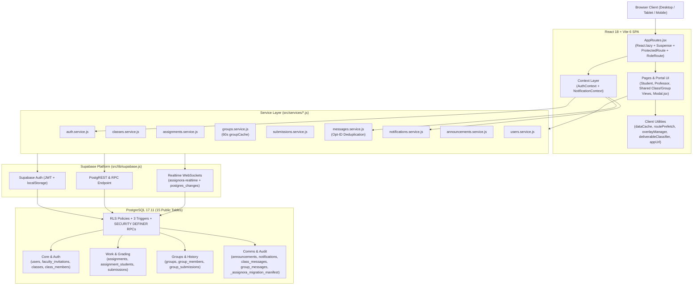
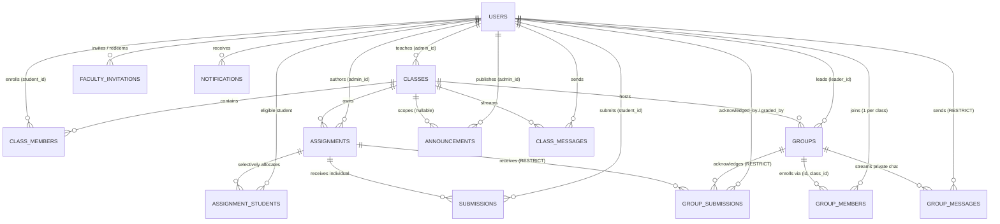

# Assignora — Student, Group & Assignment Management Platform

[](https://react.dev/)
[](https://vitejs.dev/)
[](https://tailwindcss.com/)
[](https://supabase.com/)
[](https://reactrouter.com/)
[](https://assignora-cyan.vercel.app)
[](LICENSE)

> **Assign. Track. Achieve.**
> A role-isolated academic coursework, collaborative group management, and assignment acknowledgement platform built with React 18, Vite, Tailwind CSS, and Supabase PostgreSQL.

- **Production Application**: [https://assignora-cyan.vercel.app](https://assignora-cyan.vercel.app)
- **GitHub Repository**: [https://github.com/DarshanDevadiga/assignora](https://github.com/DarshanDevadiga/assignora)

---

## Table of Contents

1. [Project Overview](#1-project-overview)
2. [Technology Stack](#2-technology-stack)
3. [Task 1 (Round 1) — Original Implementation](#3-task-1-round-1--original-implementation)
4. [Task 2 (Round 2) — Enhancement Overview & Comparison](#4-task-2-round-2--enhancement-overview--comparison)
5. [System Architecture & Data Flow](#5-system-architecture--data-flow)
6. [Authentication & Authorization Architecture](#6-authentication--authorization-architecture)
7. [Professor / Admin Workflows](#7-professor--admin-workflows)
8. [Student Workflows](#8-student-workflows)
9. [Group Governance, Integrity & Private Chat](#9-group-governance-integrity--private-chat)
10. [Submission Lifecycle, File Handling & Grading](#10-submission-lifecycle-file-handling--grading)
11. [Database Architecture & Complete Schema](#11-database-architecture--complete-schema)
12. [Entity Relationship Diagrams](#12-entity-relationship-diagrams)
13. [Database Security, Triggers, Functions & Realtime](#13-database-security-triggers-functions--realtime)
14. [Frontend Service Layer & State Contexts](#14-frontend-service-layer--state-contexts)
15. [Routing & Navigation Reference](#15-routing--navigation-reference)
16. [UI/UX Design System & Global Accessibility](#16-uiux-design-system--global-accessibility)
17. [Performance Optimizations](#17-performance-optimizations)
18. [Project Folder Structure](#18-project-folder-structure)
19. [Implemented vs Operational & Planned Status](#19-implemented-vs-operational--planned-status)
20. [Installation & Local Setup](#20-installation--local-setup)
21. [Environment Variables](#21-environment-variables)
22. [Testing & Quality Verification](#22-testing--quality-verification)
23. [Security Hygiene Notes](#23-security-hygiene-notes)
24. [Deployment (Vercel)](#24-deployment-vercel)
25. [Troubleshooting](#25-troubleshooting)
26. [Future Improvements](#26-future-improvements)
27. [Project Links](#27-project-links)

---

## 1. Project Overview

**Assignora** streamlines academic assignment distribution, student enrollment, team collaboration, deliverable acknowledgement, and grading across college and university courses.

### Core Design Principles

- **Strict Role Isolation**: Separates **Professor** workspaces (`/admin/*`, backed by database role `'admin'`) from **Student** workspaces (`/student/*`, backed by database role `'student'`).
- **Database-Enforced Academic Integrity**: Prevents duplicate individual/group submissions, stops one student from joining multiple groups in the same class, protects historical group submissions with `ON DELETE RESTRICT` foreign keys and immutability triggers, and isolates private chats via Row Level Security (RLS).
- **Resilient Auth & Profile Guarantee**: Backed by an `auth.users` signup trigger (`handle_new_user`), client self-healing profile provisioning (`register_user_profile` RPC + fallback), and verified `/auth/callback` email exchange.
- **Responsive Purple Design System**: Built around `#5B21F6` (primary), `#8B5CF6` (secondary), `#EDE9FE` (light accent), and `#F8F9FF` (background) with Inter typography across desktop, tablet, and mobile breakpoints.

---

## 2. Technology Stack

| Layer | Technology | Version / Notes |
| :--- | :--- | :--- |
| **UI Framework** | React | `^18.3.1` (Hooks, Context, `React.lazy` + `Suspense`, `createPortal`) |
| **Build Tool** | Vite | `^6.0.7` (`@vitejs/plugin-react`, manual chunk splitting) |
| **Routing** | React Router DOM | `^7.18.5` (Protected & role-guarded nested routes) |
| **Styling** | Tailwind CSS | `^3.4.17` (`autoprefixer`, `postcss`, custom CSS design tokens) |
| **Utilities** | `clsx`, `tailwind-merge` | `^2.1.1`, `^2.6.0` |
| **Icons** | `lucide-react` | `^1.16.0` |
| **Feedback Animation** | `canvas-confetti` | `^1.9.4` (dynamically imported only after submission confirmation) |
| **Linting** | ESLint + React Plugins | `^8.57.1` (`eslint-plugin-react`, `eslint-plugin-react-hooks`) |
| **Backend Platform** | Supabase | `@supabase/supabase-js` `^2.49.1` (Auth, PostgREST, Realtime WebSockets) |
| **Database Engine** | PostgreSQL | Version `17.11` managed by Supabase with RLS enabled on all public tables |
| **Hosting / SPA Routing** | Vercel | Automatic GitHub CI/CD with `vercel.json` SPA rewrites |

---

## 3. Task 1 (Round 1) — Original Implementation

Round 1 established the core full-stack application, database isolation, and academic workflow foundation. All Task 1 capabilities remain preserved inside the current application:

### Preserved Round 1 Capabilities

1. **Authentication & Session Persistence**:
   - Email/password sign-in powered by Supabase Auth (`persistSession: true`, `autoRefreshToken: true`, `detectSessionInUrl: true`).
   - Profile records stored in `public.users` with roles (`student`, `admin`), optional `student_id`, and `avatar`.
   - Route guards (`ProtectedRoute` and `RoleRoute`) enforcing authenticated access and automatic dashboard redirection.
2. **Classroom Management & Enrollment**:
   - Professors create classes (`public.classes`) with unique alphanumeric `class_code` identifiers.
   - Students enroll using join codes (`JoinClassModal`, `JoinClassPage`) or encoded class invite links (`/join`, `/join-class`, `/invite`) stored in `public.class_members`.
3. **Assignment Authoring & Selective Student Allocation**:
   - Assignments (`public.assignments`) with title, description, points (`points >= 0`), `due_date`, `due_time`, `drive_link`, and status (`draft`, `published`, `archived`).
   - Targeted delivery: cohort-wide (`assign_to_all = true`) or selected students via `public.assignment_students`.
4. **Individual Submissions & Duplicate Prevention**:
   - Students attach submission links and notes (`public.submissions`) through a two-step confirmation dialog (`TwoStepSubmissionModal`).
   - Database unique constraint `(assignment_id, student_id)` prevents duplicate submissions.
   - Letter grade calculation (`A+` to `F`) in `src/utils/calculations.js` and feedback persistence via `submissions.service.js`.
5. **Announcements, Notifications & Class Messaging**:
   - Course-level and global announcements (`public.announcements`).
   - User notifications (`public.notifications`) synchronized via `NotificationContext`.
   - Real-time classroom chat (`public.class_messages`) with per-class unread counters.
6. **Baseline Schema**:
   - 9 foundational tables (`users`, `classes`, `class_members`, `assignments`, `assignment_students`, `submissions`, `announcements`, `notifications`, `class_messages`) protected by Row Level Security.

---

## 4. Task 2 (Round 2) — Enhancement Overview & Comparison

### Objectives & Problem Statement

Round 2 upgrades Assignora from an individual coursework tracker into a production-hardened collaborative system supporting:
- Public student and invitation-gated professor self-registration with resilient profile provisioning.
- Course-specific OneDrive material links alongside existing Google Drive links.
- Dual submission modes (**Individual** vs **Group**) with **leader-only group acknowledgement** and universal team visibility.
- Server-enforced course groups (one group per student per class, leadership transfer, member leave, safe disband vs archival preservation, professor group authoring).
- Submitted vs Not-Submitted tracking with visual progress bars, search, filtering, and deliverable inspection.
- Global portal-based modals, viewport backdrops, performance optimization (lazy loading, prefetching, TTL caching), and isolated intra-group chat.

### Implemented Role Mapping

| UI Concept | Database `public.users.role` Value | Dashboard Prefix | Registration Requirement |
| :--- | :--- | :--- | :--- |
| **Student** | `'student'` | `/student` | Open public registration + optional Student ID |
| **Professor / Admin** | `'admin'` | `/admin` | Requires valid token in `public.faculty_invitations` |

### Task 1 vs Task 2 Evolution Summary

| Domain | Task 1 (Round 1) | Task 2 (Round 2) | Status |
| :--- | :--- | :--- | :--- |
| **Registration** | Baseline login / profile rows | `/register` for Student & invite-gated Professor + `handle_new_user` + `register_user_profile()` + `/auth/callback` | Implemented |
| **Class Enrollment** | Basic `class_members` insert | Security-definer `get_class_preview_by_code()` & `join_class_by_code()` RPCs + hardened `class_members` RLS | Implemented |
| **Professor Courses & Tracking** | Basic class/assignment lists | Dashboard course cards, OneDrive link field, `individual`/`group` toggle, Submitted/Not-Submitted drill-down, grading modal | Implemented |
| **Student Submission Flow** | Direct individual submission | Two-step confirmation, timestamped acknowledgement, optional client file Data URL (`<= 15 MB`) or external URL | Implemented |
| **Group Assignments** | Not present | Leader-only `acknowledge_group_assignment()` RPC + universal member banner + exact no-group alert with Create/Join CTA | Implemented |
| **Group Governance** | Not present | `groups`, `group_members`, 7 RPCs, immutability triggers, one-group-per-course unique constraint | Implemented |
| **Collaboration & Directory** | Class chat (`class_messages`) | Course `Groups` tab, `GroupDetailsPage`, `GroupDetailsModal`, private `group_messages`, peer visibility in People tab | Implemented |
| **Notifications & Auth Sync** | Basic notification fetches | Unified `assignora-realtime` channel, optimistic message deduplication, visibility-aware 45s fallback polling, full logout teardown | Implemented |
| **Performance & UI** | Eager views / inline dialogs | 21 lazy-loaded route chunks, `dataCache` (45s TTL) + `groupCache` (60s TTL), `routePrefetch`, portal `Modal` + `overlayManager` | Implemented |

---

## 5. System Architecture & Data Flow



---

## 6. Authentication & Authorization Architecture

### Registration & Profile Provisioning Flow (`Register.jsx`, `auth.service.js`, `AuthCallback.jsx`)

1. **Form Validation**: Validates non-empty full name, valid email containing `@`, password length `>= 6`, and mandatory faculty token when `role === 'admin'`.
2. **Faculty Token Validation**: If registering as a Professor (`'admin'`), `validate_faculty_invitation(p_token, p_email)` RPC checks token validity before creating the Auth user.
3. **Database Signup Trigger + RPC Guarantee**:
   - `handle_new_user()` trigger on `auth.users` provisions a `public.users` profile on creation.
   - `authService.ensureUserProfile()` invokes the `register_user_profile(p_name, p_role, p_faculty_invite_token, p_student_id)` `SECURITY DEFINER` RPC (with local session fallback) to ensure every authenticated account has exactly one matching `public.users` row without 406 single-row failures.
4. **Email Verification (`/auth/callback`)**:
   - Handles Supabase error query parameters (`error`, `error_description`).
   - Exchanges PKCE `code` via `supabase.auth.exchangeCodeForSession(code)` or verifies `token_hash` + `type` via `supabase.auth.verifyOtp()`.
   - Resolves the verified profile role and redirects to `/admin` or `/student`.

### Login, Route Protection & Session Security

- **Deterministic Redirects (`Login.jsx`, `ProtectedRoute.jsx`)**:
  - After login, redirects to `/admin` (role `'admin'`) or `/student` (role `'student'`).
  - Explicitly honors public course invite entry points (`?code=...` or whitelisted `/join`, `/join-class`, `/invite` return paths) without preserving stale `location.state.from` destinations across users on shared devices.
- **Role Translation (`RoleRoute.jsx`)**:
  - Cross-role direct URLs for assignments or classes automatically translate between `/student/assignments/:id` and `/admin/assignments/:id` (and `/classes/:id`) instead of throwing dead-end access errors when appropriate.
- **Logout Cleanup (`AuthContext.jsx`)**:
  - Clears `localStorage` key `assignora_cached_profile`, clears `sessionStorage`, flushes `dataCache` (`clearAllAppCaches()`), clears in-memory `groupCache`, and invokes `messagesService.cleanupRealtime()` / `supabase.removeAllChannels()`.

---

## 7. Professor / Admin Workflows

- **Professor Dashboard (`/admin`, `AdminDashboard.jsx`)**: Responsive overview of **Courses Taught**, active assignment counts, recent submission activity, and quick links to course workspaces.
- **Class & Student Management (`/admin/classes`, `/admin/classes/:id`, `/admin/students`)**:
  - Create/edit/delete classes with auto-generated `class_code`.
  - View enrolled student rosters (`get_class_roster` RPC), class groups tab (`ClassGroupsTab.jsx`), announcements, course resources, and real-time class chat.
  - Create or generate sharable invitation links (`InviteStudentModal.jsx`).
- **Assignment Creation & Editing (`/admin/assignments/create`, `/admin/assignments/:id/edit`, `CreateAssignment.jsx`)**:
  - Fields: Title, Description, Points, `due_date`, `due_time`, **OneDrive Link** (`onedrive_link`), **Google Drive Link** (`drive_link`), Status (`draft` / `published` / `archived`), and Submission Type (`individual` vs `group`).
  - Selective Student Allocation (`StudentSelectionModal.jsx`): Assign to entire class (`assign_to_all = true`) or a specific student subset saved in `assignment_students`.
- **Submission Tracking & Drill-Down (`/admin/assignments/:id`, `/admin/submissions`, `SubmissionTracking.jsx`)**:
  - Real-time counts for Submitted vs Not Submitted (students for individual mode, active groups for group mode), visual progress bars, search, and status filtering.
  - Direct group focus support via query param `?groupId=:groupId` (triggered by "Open Work" from group views), opening `SubmittedWorkViewerModal` / evaluation controls cleanly and restoring clean URL params on close.
  - **Grading**: Individual grades/feedback saved cleanly via `submissions.service.js` structured comment JSON (`{ text, grade, feedback }`), and group grading executed server-side via `grade_group_submission(p_submission_id, p_marks, p_feedback)` with numeric bounds checks (`0 <= p_marks <= assignment.points`).

---

## 8. Student Workflows

- **Student Dashboard (`/student`, `StudentDashboard.jsx`)**: Enrolled course cards, upcoming/overdue assignment alerts, submission stats, and instant 1-click navigation to classes or assignments.
- **Joining Classes (`JoinClassModal.jsx`, `JoinClassPage.jsx`)**: Preview class metadata via `get_class_preview_by_code(p_code)` and enroll securely via `join_class_by_code(p_code)` RPC (routes `/join`, `/join-class`, `/invite`).
- **Assignment Details View (`/student/assignments/:id`, `AssignmentDetails.jsx`)**:
  - Displays title, course context, description, deadline date & time, overdue/urgent badges (`formatDeadlineBadge`, `isOverdue`), **Submission Type** badge (`Individual` vs `Group`), clickable **OneDrive** and **Google Drive** links, and context-aware back navigation (`Back to Group`, `Back to Class Assignments`, or `Back to Assignments`).
- **Individual Submission Workflow**:
  - Student provides an external link (OneDrive, Google Drive, GitHub, etc.) or selects a local file (`<= 15 MB` client-side `FileReader` Base64 Data URL encoding) plus optional comments, then confirms via `TwoStepSubmissionModal`.
  - Records exact `submitted_at` timestamp, triggers `canvas-confetti`, and notifies class participants.
- **Group Assignment Workflow**:
  - Resolves group membership authoritatively per course (`groupsService.getStudentGroupInCourse`).
  - Checks selective assignment allocation (`assignment_students` when `assign_to_all = false`).
  - **No-Group Empty State**: Displays the exact banner:
    > `You are not part of any group. Create or join one to submit this assignment.`
    with direct **Create Group** and **Join Group** actions.
  - **Leader-Only Acknowledgement**: Only `group.leader_id` can acknowledge/submit on behalf of the team via `acknowledge_group_assignment(p_assignment_id, p_group_id, p_link, p_comment)`. Non-leader members see a read-only state indicating the leader handles submission.
  - **Universal Team Visibility**: Once submitted, all group members view `"Acknowledged by [Leader Name] on [date and time]"`, attached deliverables, notes, marks, and instructor feedback.

---

## 9. Group Governance, Integrity & Private Chat

- **In-Course Groups Tab (`ClassGroupsTab.jsx`)**: Embedded inside `/student/classes/:id` and `/admin/classes/:id` alongside Overview, Assignments, People, Messages, and Resources tabs. Uses a 4-state membership flow (`loading`, `member`, `not_member`, `error`) to prevent "No group" UI flicker while fetching.
- **One Group Per Student Per Course**: Enforced at database level by unique constraint `unique_student_per_course` on `group_members(class_id, student_id)` and transactional advisory locks inside RPCs.
- **Group Creation & Joining**:
  - Students create groups (`create_course_group` RPC; creator automatically becomes `leader_id` and first member) or join active groups (`join_course_group` RPC).
  - Professors can construct pre-assigned teams and pick initial leaders via `ProfessorCreateGroupModal.jsx` and `professor_create_group` RPC.
  - Leaders and professors can add unassigned enrolled students via `AddGroupMembersModal.jsx` and `add_group_members` RPC.
- **Leadership Transfer, Leave & Disband/Archive**:
  - Leaders transfer leadership atomically (`transfer_group_leadership` RPC).
  - Non-leader members leave freely (`leave_course_group` RPC); `trg_prevent_leader_abandonment` blocks direct leader deletion.
  - Disbanding (`disband_course_group` RPC) deletes an unused group only if zero submissions exist; if any `group_submissions` exist, the group transitions cleanly to `status = 'archived'` via `archive_course_group` / immutability guards to preserve academic history.
- **People Directory (`ClassDetailPage.jsx`)**: Instructors and enrolled peers see complete class rosters with `Leader • [Group Name]`, `[Group Name]`, and `No Group Yet` badges plus instant filters (`All`, `Leaders`, `In a Group`, `Without Group`).
- **Group Details Workspace (`GroupDetailsPage.jsx`, `GroupDetailsModal.jsx`)**:
  - Direct bookmarkable full page at `/classes/:classId/groups/:groupId`, `/student/classes/:classId/groups/:groupId`, and `/admin/classes/:classId/groups/:groupId`.
  - Tabs: `Overview`, `Members`, `Group Assignments` (strictly filtered to `submission_type = 'group'` and eligible selective allocations), and `Private Group Chat`.
  - Role-styled chat badges (`Professor`, `Admin`, `Leader`, `Member`) persisted in `public.group_messages` and synced over Realtime only while authorized (`isMember || isTeacher`) and active on the chat tab.

---

## 10. Submission Lifecycle, File Handling & Grading

### Deliverable Classification (`src/utils/deliverableClassifier.js`, `src/components/submission/SubmittedWorkViewerModal.jsx`)

Deliverables attached in `submission_link` are sanitized and classified client-side into:
- `acknowledgement_only`: Empty `submission_link` (acknowledgement timestamp recorded without external file/link).
- `pdf` / `image` / `file`: Browser-encoded `data:` URLs (`<= 15 MB` via `FileReader.readAsDataURL` in `AssignmentDetails.jsx`) or external PDF URLs with inline preview where supported.
- Office / Cloud / Code URLs (`word`, `excel`, external OneDrive/Google Drive/GitHub links) with safe external opening and circular self-link protection (`resolveDeliverableUrl` in `calculations.js`).

> **Important Technical Note**: Supabase Storage (`storage.buckets` and `storage.objects`) is currently **unused** (`0` buckets deployed). Binary file uploads selected by students in `AssignmentDetails.jsx` are base64-encoded client-side into `Data URLs` (max `15 MB`) and saved in `submission_link`, or students submit external OneDrive / Google Drive URLs.

### Submission Status Values

- **Individual (`public.submissions.status`)**: `'submitted'`, `'late'`, `'reviewed'` (constrained via `CHECK` constraint). Instructor numeric/text grading metadata is serialized safely inside `submissions.comment` as JSON (`{"text","grade","feedback"}`) by `submissionsService.buildSubmissionComment()` / `parseSubmissionComment()` while preserving backward compatibility with plain-text notes.
- **Group (`public.group_submissions.status`)**: `'submitted'`, `'reviewed'` (constrained via `CHECK` constraint), with dedicated numeric/audit grading columns: `marks`, `feedback`, `graded_by`, `graded_at`.

---

## 11. Database Architecture & Complete Schema

Verified directly against live PostgreSQL `17.11` (`public` schema): **15 active tables** with **Row Level Security enabled** across user/domain tables.

### 11.1 Identity & Onboarding

#### `public.users`
| Column | Type | Nullable | Default | Constraints & Notes |
| :--- | :--- | :--- | :--- | :--- |
| `id` | `uuid` | NO | — | `PK`; `FK users_auth_id_fkey -> auth.users(id) ON DELETE CASCADE` |
| `name` | `text` | NO | — | Full display name |
| `email` | `text` | NO | — | `UNIQUE (users_email_key)` |
| `role` | `text` | NO | `''::text` | Application roles: `'student'` or `'admin'` (Professor) |
| `avatar` | `text` | YES | — | Optional avatar URL/string |
| `student_id` | `text` | YES | — | Optional institutional roll/student ID |
| `created_at` | `timestamptz` | NO | `now()` | Account profile creation timestamp |

#### `public.faculty_invitations`
| Column | Type | Nullable | Default | Constraints & Notes |
| :--- | :--- | :--- | :--- | :--- |
| `id` | `uuid` | NO | `gen_random_uuid()` | `PK` |
| `token` | `varchar` | NO | — | `UNIQUE (faculty_invitations_token_key)` |
| `email` | `text` | YES | — | Optional email lock for invitation |
| `department` | `varchar` | YES | `'Academic Faculty'` | Department metadata |
| `invited_by` | `uuid` | YES | — | `FK -> public.users(id) ON DELETE SET NULL` |
| `is_used` | `boolean` | NO | `false` | Consumption flag |
| `used_by` | `uuid` | YES | — | `FK -> public.users(id) ON DELETE SET NULL` |
| `used_at` | `timestamptz` | YES | — | Timestamp consumed |
| `expires_at` | `timestamptz` | YES | `now() + '90 days'` | Expiration window |
| `created_at` | `timestamptz` | NO | `now()` | Record creation time |

---

### 11.2 Course Management

#### `public.classes`
| Column | Type | Nullable | Default | Constraints & Notes |
| :--- | :--- | :--- | :--- | :--- |
| `id` | `uuid` | NO | `gen_random_uuid()` | `PK` |
| `name` | `text` | NO | — | Course title |
| `subject` | `text` | NO | — | Subject/department |
| `description` | `text` | YES | — | Course overview |
| `admin_id` | `uuid` | NO | — | `FK fk_classes_admin -> public.users(id) ON DELETE CASCADE` |
| `class_code` | `varchar` | NO | `...` | `UNIQUE (classes_class_code_key)` join code |
| `created_at` | `timestamptz` | NO | `now()` | Created timestamp |

#### `public.class_members`
| Column | Type | Nullable | Default | Constraints & Notes |
| :--- | :--- | :--- | :--- | :--- |
| `id` | `uuid` | NO | `gen_random_uuid()` | `PK` |
| `class_id` | `uuid` | NO | — | `FK -> public.classes(id) ON DELETE CASCADE` |
| `student_id` | `uuid` | NO | — | `FK -> public.users(id) ON DELETE CASCADE` |
| `joined_at` | `timestamptz` | NO | `now()` | `UNIQUE (class_id, student_id)` (`class_members_class_id_student_id_key`) |

---

### 11.3 Assignment Authoring & Allocation

#### `public.assignments`
| Column | Type | Nullable | Default | Constraints & Notes |
| :--- | :--- | :--- | :--- | :--- |
| `id` | `uuid` | NO | `gen_random_uuid()` | `PK` |
| `title` | `text` | NO | — | Assignment title |
| `description` | `text` | YES | — | Instructions & criteria |
| `class_id` | `uuid` | NO | — | `FK -> public.classes(id) ON DELETE CASCADE` |
| `admin_id` | `uuid` | NO | — | `FK -> public.users(id) ON DELETE CASCADE` |
| `due_date` | `date` | NO | — | Deadline date |
| `due_time` | `time` | YES | — | Optional deadline time |
| `drive_link` | `text` | YES | — | Google Drive / resource link |
| `onedrive_link` | `text` | YES | — | **Round 2**: OneDrive folder/document link |
| `points` | `integer` | NO | `100` | `CHECK (points >= 0)` |
| `assign_to_all` | `boolean` | NO | `true` | Cohort-wide vs selective toggle |
| `status` | `text` | NO | `'published'` | `CHECK (status IN ('draft', 'published', 'archived'))` |
| `submission_type` | `varchar` | NO | `'individual'` | **Round 2**: `CHECK (submission_type IN ('individual', 'group'))` |
| `created_at` | `timestamptz` | NO | `now()` | Created timestamp |
| `updated_at` | `timestamptz` | NO | `now()` | Last update timestamp |

#### `public.assignment_students`
| Column | Type | Nullable | Default | Constraints & Notes |
| :--- | :--- | :--- | :--- | :--- |
| `id` | `uuid` | NO | `gen_random_uuid()` | `PK` |
| `assignment_id` | `uuid` | NO | — | `FK -> public.assignments(id) ON DELETE CASCADE` |
| `student_id` | `uuid` | NO | — | `FK -> public.users(id) ON DELETE CASCADE` |
| `assigned_at` | `timestamptz` | NO | `now()` | `UNIQUE (assignment_id, student_id)` |

---

### 11.4 Collaboration & Groups (Round 2)

#### `public.groups`
| Column | Type | Nullable | Default | Constraints & Notes |
| :--- | :--- | :--- | :--- | :--- |
| `id` | `uuid` | NO | `gen_random_uuid()` | `PK`; part of `UNIQUE uq_groups_id_class_id (id, class_id)` |
| `class_id` | `uuid` | NO | — | `FK -> public.classes(id) ON DELETE CASCADE` |
| `name` | `varchar` | NO | — | Unique index `idx_groups_class_id_name_ci` on `(class_id, lower(name))` |
| `leader_id` | `uuid` | NO | — | `FK -> public.users(id) ON DELETE RESTRICT` |
| `status` | `varchar` | NO | `'active'` | `CHECK (status IN ('active', 'archived'))` |
| `created_at` | `timestamptz` | NO | `now()` | Created timestamp |

#### `public.group_members`
| Column | Type | Nullable | Default | Constraints & Notes |
| :--- | :--- | :--- | :--- | :--- |
| `id` | `uuid` | NO | `gen_random_uuid()` | `PK` |
| `group_id` | `uuid` | NO | — | Composite `FK fk_group_members_group_class (group_id, class_id) -> groups(id, class_id) ON DELETE CASCADE` |
| `class_id` | `uuid` | NO | — | Part of composite FK and `UNIQUE unique_student_per_course (class_id, student_id)` |
| `student_id` | `uuid` | NO | — | `FK -> public.users(id) ON DELETE CASCADE`; `UNIQUE unique_group_student (group_id, student_id)` |
| `joined_at` | `timestamptz` | YES | `now()` | Membership timestamp |

---

### 11.5 Submissions & Acknowledgements

#### `public.submissions` (Individual Deliverables)
| Column | Type | Nullable | Default | Constraints & Notes |
| :--- | :--- | :--- | :--- | :--- |
| `id` | `uuid` | NO | `gen_random_uuid()` | `PK` |
| `assignment_id` | `uuid` | NO | — | `FK -> public.assignments(id) ON DELETE CASCADE` |
| `student_id` | `uuid` | NO | — | `FK -> public.users(id) ON DELETE CASCADE` |
| `submission_link` | `text` | YES | — | External URL or client Data URL |
| `comment` | `text` | YES | — | Student note or serialized `{text, grade, feedback}` JSON |
| `status` | `text` | NO | `'submitted'` | `CHECK (status IN ('submitted', 'late', 'reviewed'))` |
| `submitted_at` | `timestamptz` | NO | `now()` | `UNIQUE (assignment_id, student_id)` |
| `updated_at` | `timestamptz` | NO | `now()` | Updated timestamp |

#### `public.group_submissions` (Round 2 Group Acknowledgements & Grading)
| Column | Type | Nullable | Default | Constraints & Notes |
| :--- | :--- | :--- | :--- | :--- |
| `id` | `uuid` | NO | `gen_random_uuid()` | `PK` |
| `assignment_id` | `uuid` | NO | — | `FK -> public.assignments(id) ON DELETE RESTRICT` |
| `group_id` | `uuid` | NO | — | `FK -> public.groups(id) ON DELETE RESTRICT`; `UNIQUE unique_assignment_group_submission (assignment_id, group_id)` |
| `acknowledged_by` | `uuid` | NO | — | `FK -> public.users(id) ON DELETE RESTRICT` |
| `acknowledged_at` | `timestamptz` | NO | `now()` | Official acknowledgement timestamp |
| `submission_link` | `text` | YES | — | Deliverable link / Data URL |
| `comment` | `text` | YES | — | Leader submission note |
| `status` | `varchar` | NO | `'submitted'` | `CHECK (status IN ('submitted', 'reviewed'))` |
| `marks` | `numeric` | YES | — | Numeric score (`0..points`) |
| `feedback` | `text` | YES | — | Instructor qualitative feedback |
| `graded_by` | `uuid` | YES | — | `FK -> public.users(id) ON DELETE SET NULL` |
| `graded_at` | `timestamptz` | YES | — | Grading timestamp |
| `created_at` | `timestamptz` | NO | `now()` | Created timestamp |
| `updated_at` | `timestamptz` | NO | `now()` | Updated timestamp |

---

### 11.6 Communication & Notifications

#### `public.announcements`
| Column | Type | Nullable | Default | Constraints & Notes |
| :--- | :--- | :--- | :--- | :--- |
| `id` | `uuid` | NO | `gen_random_uuid()` | `PK` |
| `title` | `text` | NO | — | Announcement headline |
| `message` | `text` | NO | — | Announcement body text |
| `admin_id` | `uuid` | NO | — | `FK -> public.users(id) ON DELETE CASCADE` |
| `class_id` | `uuid` | YES | — | `FK -> public.classes(id) ON DELETE CASCADE` (`NULL` = global) |
| `is_published` | `boolean` | NO | `true` | Visibility toggle |
| `created_at` | `timestamptz` | NO | `now()` | Created timestamp |
| `updated_at` | `timestamptz` | NO | `now()` | Updated timestamp |

#### `public.notifications`
| Column | Type | Nullable | Default | Constraints & Notes |
| :--- | :--- | :--- | :--- | :--- |
| `id` | `uuid` | NO | `gen_random_uuid()` | `PK` |
| `user_id` | `uuid` | NO | — | `FK -> public.users(id) ON DELETE CASCADE` |
| `title` | `text` | NO | — | Notification title |
| `message` | `text` | NO | — | Notification message |
| `type` | `text` | NO | `'general'` | `CHECK (type IN ('assignment', 'submission', 'announcement', 'reminder', 'general'))` |
| `reference_id` | `uuid` | YES | — | Application-level polymorphic entity ID (class, assignment, or submission UUID; **no DB foreign key**) |
| `is_read` | `boolean` | NO | `false` | Read status flag |
| `created_at` | `timestamptz` | NO | `now()` | Created timestamp |

#### `public.class_messages`
| Column | Type | Nullable | Default | Constraints & Notes |
| :--- | :--- | :--- | :--- | :--- |
| `id` | `uuid` | NO | `gen_random_uuid()` | `PK` |
| `class_id` | `uuid` | NO | — | `FK -> public.classes(id) ON DELETE CASCADE` |
| `sender_id` | `uuid` | NO | — | `FK -> public.users(id) ON DELETE CASCADE` |
| `message` | `text` | NO | — | Classroom chat body |
| `created_at` | `timestamptz` | YES | `now()` | Message timestamp |

#### `public.group_messages`
| Column | Type | Nullable | Default | Constraints & Notes |
| :--- | :--- | :--- | :--- | :--- |
| `id` | `uuid` | NO | `gen_random_uuid()` | `PK` |
| `group_id` | `uuid` | NO | — | `FK -> public.groups(id) ON DELETE CASCADE` |
| `sender_id` | `uuid` | NO | — | `FK -> public.users(id) ON DELETE RESTRICT` |
| `message` | `text` | NO | — | `CHECK (char_length(trim(message)) > 0 AND char_length(message) <= 5000)` |
| `created_at` | `timestamptz` | NO | `now()` | Message timestamp |

---

### 11.7 Migration Governance

#### `public._assignora_migration_manifest`
| Column | Type | Nullable | Default | Constraints & Notes |
| :--- | :--- | :--- | :--- | :--- |
| `object_type` | `text` | NO | — | Composite `PK` (`object_type, object_schema, object_name, sub_object_name`) |
| `object_schema` | `text` | NO | — | Schema name |
| `object_name` | `text` | NO | — | Created object identifier |
| `sub_object_name` | `text` | NO | `''::text` | Sub-object name (policy/index/column) |
| `created_by_migration` | `text` | NO | — | Migration version stamp |
| `created_at` | `timestamptz` | NO | `now()` | Audit timestamp |

### Database Indexes Summary (54 Production Indexes)

Beyond primary keys and unique constraint indexes (`users_email_key`, `classes_class_code_key`, `faculty_invitations_token_key`, `class_members_class_id_student_id_key`, `assignment_students_assignment_id_student_id_key`, `submissions_assignment_id_student_id_key`, `unique_assignment_group_submission`, `unique_group_student`, `unique_student_per_course`, `uq_groups_id_class_id`, `idx_groups_class_id_name_ci`), PostgreSQL maintains targeted lookup indexes including:
- `idx_assignments_admin`, `idx_assignments_class`, `idx_assignments_due_date`
- `idx_assignment_students_student`, `idx_class_members_class`, `idx_class_members_student`
- `idx_announcements_class`, `idx_notifications_user`, `idx_notifications_unread`
- `idx_submissions_assignment`, `idx_submissions_student`
- `idx_groups_class_id`, `idx_groups_leader_id`, `idx_groups_status`
- `idx_group_members_class_id`, `idx_group_members_group_id`, `idx_group_members_student_id`
- `idx_group_subs_assignment`, `idx_group_subs_group`, `idx_group_subs_acknowledged_by`
- `idx_class_messages_class_id`, `idx_class_messages_created_at`, `idx_class_messages_sender_id`
- `idx_group_messages_group_created (group_id, created_at)`, `idx_group_messages_sender_id`
- `idx_faculty_invitations_is_used`, `idx_faculty_invitations_token`, `idx_classes_class_code`

---

## 12. Entity Relationship Diagrams



> **Application-Level Link Note**: `notifications.reference_id` stores a target `class_id`, `assignment_id`, or `submission_id` UUID at the application layer without a PostgreSQL foreign key constraint so alerts remain lightweight across multiple entity types.

---

## 13. Database Security, Triggers, Functions & Realtime

### Row Level Security (RLS) Design

All application tables enforce RLS for the `authenticated` role:
- **`users`**: Users can read/update their own row (`id = auth.uid()`, with role locked via `current_user_role()`); instructors read enrolled students via `classes`/`class_members`; classmates read peer profiles via `is_classmate_of(id)` and students read instructors via `is_instructor_of_caller(id)`. Professor inserts (`role = 'admin'`) require a consumed `faculty_invitations` row (`used_by = auth.uid() AND is_used = true`).
- **`classes` & `class_members`**: Class owners manage classes and enrollments (`is_class_admin`); students see classes they belong to (`is_class_member`), see peer classmates (`class_members_peer_select_policy`), and can self-enroll only with `'student'` role.
- **`assignments` & `assignment_students`**: Course instructors author/update/delete; enrolled students view published assignments only when `assign_to_all = true` OR listed in `assignment_students`.
- **`groups`, `group_members`, `group_submissions`**: Direct client `INSERT`/`DELETE` policies are intentionally **closed (`WITH CHECK (false)` / `USING (false)`)**; all creation, joining, leaving, leadership transfer, disbanding, member additions, group acknowledgement, and group grading must pass through validated `SECURITY DEFINER` RPCs with fixed `SET search_path TO 'pg_catalog', 'pg_temp'`.
- **`class_messages` & `group_messages`**: Scoped strictly to course participants / active group members and instructors (`sender_id = auth.uid()` on inserts).

### Database Triggers (3)

| Trigger Name | Table | Timing & Event | Trigger Function | Enforcement Purpose |
| :--- | :--- | :--- | :--- | :--- |
| `trg_prevent_leader_abandonment` | `public.group_members` | `BEFORE DELETE` | `check_group_member_deletion()` | Prevents deleting a group leader from a team before leadership transfer or disband |
| `trg_protect_group_submission_immutables` | `public.group_submissions` | `BEFORE UPDATE` | `check_group_submission_immutables()` | Locks immutable acknowledgement identity (`assignment_id`, `group_id`, `acknowledged_by`, `acknowledged_at`) |
| `trg_protect_group_immutables` | `public.groups` | `BEFORE UPDATE OR DELETE` | `check_group_immutables()` | Protects `class_id`/identity, enforces authorized archival/deletion context, preserves groups with submissions |

### Deployed PostgreSQL Functions (`public`, 30 `SECURITY DEFINER` Functions)

- **Auth & Invitations**: `handle_new_user()`, `register_user_profile(p_name, p_role, p_faculty_invite_token, p_student_id)`, `create_faculty_invitation(p_email, p_department)`, `validate_faculty_invitation(p_token, p_email)`, `current_user_role()`, `is_admin()`
- **Classroom & Enrollment**: `get_class_preview_by_code(p_code)`, `join_class_by_code(p_code)`, `get_class_roster(p_class_id)`, `is_class_admin(p_class_id)`, `is_class_member(p_class_id)`, `is_classmate_of(p_user_id)`, `is_instructor_of_caller(p_instructor_id)`
- **Assignments & Notifications**: `can_view_assignment(p_assignment_id)`, `is_assignment_admin(p_assignment_id)`, `create_class_notification(p_user_id, p_title, p_message, p_type, p_reference_id)`
- **Groups & Submissions**: `create_course_group(p_class_id, p_name)`, `join_course_group(p_group_id)`, `leave_course_group(p_group_id)`, `transfer_group_leadership(p_group_id, p_new_leader_id)`, `disband_course_group(p_group_id)`, `archive_course_group(p_group_id)`, `professor_create_group(p_class_id, p_name, p_member_ids, p_leader_id)`, `add_group_members(p_group_id, p_student_ids)`, `acknowledge_group_assignment(p_assignment_id, p_group_id, p_link, p_comment)`, `grade_group_submission(p_submission_id, p_marks, p_feedback)`
- **Trigger & Platform Governance**: `check_group_immutables()`, `check_group_member_deletion()`, `check_group_submission_immutables()`, `rls_auto_enable()`

### Supabase Realtime Publication (`supabase_realtime`)

Tables enabled in `supabase_realtime`:
`class_messages`, `group_members`, `group_messages`, `group_submissions`, `groups`, `users`.

---

## 14. Frontend Service Layer & State Contexts

### Services (`src/services/*.js`)

| Service | Primary Responsibilities |
| :--- | :--- |
| `auth.service.js` | `signUp`, `signIn`, `signOut`, `resetPasswordForEmail`, `getSession`, `getCurrentUser`, `getUserProfile`, `ensureUserProfile`, `onAuthStateChange`, `clearProfileCache` |
| `classes.service.js` | `getAdminClasses`, `getStudentClasses`, `getClassById`, `getClassRoster`, `createClass`, `updateClass`, `deleteClass`, `findClassByCode`, `joinClassByCode`, `enrollStudent`, `addMember`, `removeMember`, `generateInviteToken`, `verifyInviteToken`, `getClassActivity`, `getClassResources` |
| `assignments.service.js` | `getAdminAssignments`, `getAdminAssignmentSummaries`, `getAssignmentById`, `createAssignment`, `updateAssignment`, `deleteAssignment` (syncing `assignment_students` selective lists) |
| `groups.service.js` | `getCourseGroups`, `getStudentGroupInCourse`, `getGroupById`, `createCourseGroup`, `joinCourseGroup`, `leaveCourseGroup`, `transferGroupLeadership`, `disbandCourseGroup`, `acknowledgeGroupAssignment`, `getGroupSubmission`, `getAllGroupSubmissionsForAssignment`, `getGroupAssignmentHistory`, `getGroupMessages`, `sendGroupMessage`, `gradeGroupSubmission`, `professorCreateGroup`, `addGroupMembers`, `getClassStudentsGroupStatus` |
| `submissions.service.js` | `getStudentSubmissions`, `getStudentAssignmentSubmission`, `submitAssignment`, `parseSubmissionComment`, `buildSubmissionComment`, `saveGrade`, `gradeSubmission`, `getClassSubmissions` |
| `announcements.service.js` | `getClassAnnouncements`, `getAnnouncements`, `getAnnouncementsForClasses`, `createAnnouncement`, `deleteAnnouncement` |
| `notifications.service.js` | `getUserNotifications`, `markAsRead`, `markAllAsRead`, `createNotification`, `notifyClassMembers`, `formatBadge` |
| `messages.service.js` | Shared `assignora-realtime` broadcast + `class_messages` CRUD (`getClassMessages`, `sendMessage`), optimistic ID reconciliation (`opt-*`), read-timestamp tracking (`getLastReadTimestamp`, `markClassAsRead`, `getUnreadCount`) |
| `users.service.js` | `getStudents`, `getUserById`, `updateProfile`, `updatePassword` |

### Context Providers

- **`AuthContext.jsx`**: Hydrates initial shell from `assignora_cached_profile` in `localStorage` for non-blocking render, reconciles Supabase Auth session/profile asynchronously, exposes `authUser`, `profile`, `signIn`, `signUp`, `signOut`, `refreshProfile`, and purges caches + channels on `SIGNED_OUT`.
- **`NotificationContext.jsx`**: Loads notifications and calculates unread counts across enrolled/taught classes via single indexed queries (`limit(100)`), connects a single shared `assignora-realtime` broadcast listener + local bus subscription, and runs a 45-second visibility-aware sync interval.

---

## 15. Routing & Navigation Reference

### Application Routes (`src/routes/AppRoutes.jsx`)

- **Public & Entry Routes**:
  - `/` (`LandingPage`)
  - `/login` (`Login`), `/register` (`Register`)
  - `/dashboard` (Role-aware redirect to `/admin`, `/student`, or `/login`)
  - `/join`, `/join-class`, `/invite` (`JoinClassPage`)
  - `/auth/callback` (`AuthCallback`)
- **Professor / Admin Routes (`/admin`, `RoleRoute requiredRole="admin"`)**:
  - `/admin` (`AdminDashboard`)
  - `/admin/classes`, `/admin/classes/:id`, `/admin/classes/:id/people`
  - `/admin/classes/:classId/groups/:groupId` (`GroupDetailsPage`)
  - `/admin/assignments`, `/admin/assignments/create`, `/admin/assignments/:id/edit`, `/admin/assignments/:id` (`SubmissionTracking`)
  - `/admin/submissions` (`SubmissionTracking`)
  - `/admin/grades`, `/admin/reports` (`GradesGradebook`)
  - `/admin/students` (`StudentsManagement`), `/admin/announcements` (`AnnouncementsManagement`)
  - `/admin/profile` (`ProfilePage`), `/admin/settings` (`SettingsPage`)
- **Student Routes (`/student`, `RoleRoute requiredRole="student"`)**:
  - `/student` (`StudentDashboard`)
  - `/student/classes`, `/student/classes/:id`, `/student/classes/:id/people`
  - `/student/classes/:classId/groups/:groupId` (`GroupDetailsPage`)
  - `/student/assignments` (`StudentDashboard`), `/student/progress` (`StudentDashboard`), `/student/assignments/:id` (`AssignmentDetails`)
  - `/student/submissions` (`StudentSubmissions`), `/student/announcements` (`StudentAnnouncements`)
  - `/student/profile` (`ProfilePage`), `/student/settings` (`SettingsPage`)
- **Direct Shared & Fallback Routes**:
  - `/classes/:classId/groups/:groupId` (`ProtectedRoute` -> `GroupDetailsPage`)
  - `/404` & `*` (`NotFound`)

### Navigation Links (`Sidebar.jsx` & `MobileNav.jsx`)

- **Admin Desktop Sidebar**: `Dashboard` (`/admin`), `Classes` (`/admin/classes`), `Assignments` (`/admin/assignments`), `Students` (`/admin/students`), `Announcements` (`/admin/announcements`), `Teachers` (`/admin/profile`), `Settings` (`/admin/settings`).
- **Student Desktop Sidebar**: `Dashboard` (`/student`), `My Classes` (`/student/classes`), `Announcements` (`/student/announcements`), `Profile` (`/student/profile`), `Settings` (`/student/settings`).
- **Mobile Bottom Bar**: `Home`, `Classes`, `Students`/`Announcements`, and `More` drawer trigger.

---

## 16. UI/UX Design System & Global Accessibility

- **Brand Palette (`tailwind.config.js`, `src/index.css`)**:
  - Primary `#5B21F6`, Hover `#4C1D95`, Secondary `#8B5CF6`, Light `#EDE9FE`, Secondary BG `#F5F3FF`, App BG `#F8F9FF`, Typography `Inter`.
- **Global Portal Modal System (`src/components/common/Modal.jsx`, `src/utils/overlayManager.js`)**:
  - Renders all dialogs via React `createPortal(..., document.body)` so parent container `overflow` or `transform` properties never clip backdrops or dialogs.
  - Managed Escape-key overlay stack (`registerOverlay`), automatic body scroll locking, responsive `max-h-[calc(100dvh-2rem)]` internal scrolling, focus restoration on close, and standardized z-index scale (`z-header: 20`, `z-dropdown: 30`, `z-sidebar: 40`, `z-drawer: 50`, `z-modal: 60`, `z-toast: 70`).
- **Motion & Accessibility**:
  - Smooth GPU transitions (`.card-premium-hover`, `.page-enter`, `.modal-enter`, `.skeleton-shimmer`) paired with `@media (prefers-reduced-motion: reduce)` handling.

---

## 17. Performance Optimizations

1. **Route-Level Code Splitting (`AppRoutes.jsx`)**: Lazy-loads 21 route components plus `DashboardLayout` via `React.lazy()` and `Suspense` (`PageSkeleton` fallback).
2. **Route Prefetching (`src/utils/routePrefetch.js`)**: Preloads role-critical route chunks via `requestIdleCallback` after login (`prefetchRoleCoreRoutes`) and on sidebar/mobile link `onMouseEnter` / `onFocus` / `onTouchStart` (`prefetchRoute`).
3. **Vite Manual Chunk Splitting (`vite.config.js`)**: Splits core vendor bundles (`vendor` for `react`, `react-dom`, `react-router-dom`; `supabase` for `@supabase/supabase-js`) while `canvas-confetti` loads dynamically via `import('canvas-confetti')` inside `TwoStepSubmissionModal.jsx`.
4. **TTL Query Caching & In-Flight Deduplication (`src/utils/dataCache.js`)**: Caches service queries (`DEFAULT_TTL_MS = 45000`) and deduplicates concurrent identical requests (`fetchWithCache`), plus `groups.service.js` `groupCache` (60s TTL) with targeted prefix invalidation on mutations.
5. **Realtime Optimization**: Uses `membersRef` / `currentUserRef` in group chat views to avoid socket teardown `1006` loops on roster re-renders, activates group chat listeners only on the active chat tab, and gates background polling with `document.hidden` visibility checks.

---

## 18. Project Folder Structure

```text
assignora/
├── index.html                        # Entry HTML, SVG icon & Inter Google Font links
├── package.json                      # Scripts (dev, build, preview, lint) & dependencies
├── tailwind.config.js                # Brand colors, Inter font, shadows, z-index scale
├── vercel.json                       # SPA fallback rewrite to /index.html
├── vite.config.js                    # Dev port 5173 & manualChunks (vendor, supabase)
├── .eslintrc.cjs                     # ESLint + React Hooks enforcement
├── .env.example                      # Safe placeholder environment variables
├── AGENTS.md                         # Persistent project brief & DB governance rules
├── ROUND2_STATUS.md                  # Milestone status & verification log
├── scripts/                          # Node/Playwright database & E2E verification scripts (27 scripts)
├── supabase/
│   ├── migrations/                   # 7 SQL migrations + preflight, verification & rollback scripts
│   └── ops/                          # Staged operational cleanup, rollback & seeding SQL scripts
└── src/
    ├── App.jsx                       # ErrorBoundary, BrowserRouter, AuthProvider, NotificationProvider
    ├── index.css                     # CSS custom properties, utility classes & animations
    ├── main.jsx                      # React DOM entry point
    ├── components/
    │   ├── admin/                    # StudentSelectionModal
    │   ├── class/                    # ClassGroupsTab, InviteStudentModal, JoinClassModal, StudentProfileModal
    │   ├── common/                   # Badge, Button, Card, ErrorBoundary, Input, Modal, NotificationBadge,
    │   │                             # NotificationsDrawer, ProgressBar, SearchInput, StatCard
    │   ├── group/                    # AddGroupMembersModal, GroupDetailsModal, GroupManagementModal,
    │   │                             # ProfessorCreateGroupModal
    │   ├── layout/                   # DashboardLayout, Header, MobileNav, Sidebar
    │   ├── student/                  # TwoStepSubmissionModal
    │   └── submission/               # GroupSubmissionCard, SubmittedWorkViewerModal
    ├── context/                      # AuthContext.jsx, NotificationContext.jsx
    ├── hooks/                        # useAuth.js
    ├── lib/                          # supabase.js
    ├── pages/
    │   ├── admin/                    # AdminDashboard, AnnouncementsManagement, AssignmentsList,
    │   │                             # ClassesManagement, CreateAssignment, GradesGradebook,
    │   │                             # StudentsManagement, SubmissionTracking
    │   ├── shared/                   # ClassDetailPage, GroupDetailsPage, JoinClassPage,
    │   │                             # NotFound, ProfilePage, SettingsPage
    │   ├── student/                  # AssignmentDetails, StudentAnnouncements, StudentDashboard,
    │   │                             # StudentSubmissions
    │   ├── AuthCallback.jsx
    │   ├── LandingPage.jsx
    │   ├── Login.jsx
    │   └── Register.jsx
    ├── routes/                       # AppRoutes.jsx, ProtectedRoute.jsx, RoleRoute.jsx
    ├── services/                     # announcements, assignments, auth, classes, groups, messages,
    │                                 # notifications, submissions, users
    └── utils/                        # appUrl, calculations, dataCache, deliverableClassifier,
                                      # overlayManager, routePrefetch
```

---

## 19. Implemented vs Operational & Planned Status

| Category | Item | Current State |
| :--- | :--- | :--- |
| **Application Code** | Round 1 & Round 2 Student, Professor, Group, Submission & Chat flows | **Implemented** in `src/` |
| **Database Schema** | 15 public tables, 54 indexes, RLS policies, 3 triggers, 30 functions, 6 Realtime tables | **Deployed** on Supabase PostgreSQL 17.11 |
| **File Attachment Storage** | Student uploads via `FileReader` Data URL (`<= 15 MB`) & OneDrive/Drive URLs | **Implemented** client-side; `storage.buckets` (`0` buckets) not yet adopted |
| **Operational DB Scripts** | `supabase/ops/{cleanup_round2_test_data.sql, rollback_round2_test_data.sql, seed_round2_demo_data.sql}` | **Staged locally** for manual SQL Editor review (not executed automatically) |

---

## 20. Installation & Local Setup

```bash
# 1. Clone the repository
git clone https://github.com/DarshanDevadiga/assignora.git
cd assignora

# 2. Install dependencies
npm install

# 3. Create your local environment file from the template
cp .env.example .env

# 4. Update .env with your own Supabase project URL and publishable key

# 5. Start the Vite development server (http://localhost:5173)
npm run dev
```

Available npm scripts:
- `npm run dev` — Start Vite dev server on port `5173`.
- `npm run build` — Build production bundle into `dist/`.
- `npm run preview` — Preview built bundle locally.
- `npm run lint` — Run ESLint across `src/` (`--ext .js,.jsx`).

---

## 21. Environment Variables

Configure `.env` based on `.env.example` using **non-secret public client settings only** (never commit `.env`, `service_role` keys, or database passwords):

```env
# Supabase Project Configuration
VITE_SUPABASE_URL=https://your-project-id.supabase.co
VITE_SUPABASE_PUBLISHABLE_KEY=your_supabase_publishable_key
VITE_SUPABASE_ANON_KEY=your_supabase_anon_key

# Application Base URL (used for auth email redirect callbacks)
VITE_APP_URL=https://assignora-cyan.vercel.app
```

> `src/lib/supabase.js` reads `VITE_SUPABASE_PUBLISHABLE_KEY` first and falls back to `VITE_SUPABASE_ANON_KEY`. `src/utils/appUrl.js` resolves `VITE_APP_URL` for Supabase email verification callbacks and defaults safely between local origins in development and `https://assignora-cyan.vercel.app` in production builds.

---

## 22. Testing & Quality Verification

### Standard Build & Static Checks

```bash
npm run lint
npm run build
```

### Repository Verification Suites (`scripts/`)

The `scripts/` directory contains 27 integration, invariant, performance, and Playwright browser E2E scripts (including `verify-round2-database-invariants.js`, `verify-group-fixes-e2e.js`, `verify-group-page-and-membership-flow.js`, `verify-group-chat-and-filtering.js`, `verify-advanced-people-and-groups.js`, `verify-registration-profiles-and-enrollment-rls.js`, `verify-submission-full.js`, `verify-messaging-and-performance.js`, and `verify-ui-browser-e2e.mjs`). Note that running scripts against Supabase requires local `.env` credentials and environment-appropriate test accounts.

### Manual End-to-End QA Checklist

1. Register a Student account and verify profile creation in `public.users` + redirect to `/student`.
2. Verify Professor registration rejects missing/invalid `faculty_invitations` tokens.
3. Join a class by `class_code` (`join_class_by_code` RPC) and verify peer visibility in the People tab.
4. Confirm Individual submission creates a single timestamped record and blocks duplicates.
5. Verify Group Assignment shows exact no-group prompt when unassigned, creates/joins a group with one-group-per-class enforcement, allows only `leader_id` to acknowledge, and shows `"Acknowledged by [Leader Name] on [date and time]"` across all members.
6. Test Professor submission tracking drill-down (`Submitted` vs `Not Submitted`), search/filter, individual grading, and `grade_group_submission()` bounds enforcement.

---

## 23. Security Hygiene Notes

- Keep `.env` untracked (never commit live URLs, JWT keys, `service_role` tokens, or database passwords into `README.md` or application bundles).
- Several standalone verification and seeding scripts under `scripts/` contain hardcoded test-account passwords or Supabase project references from earlier testing phases; sanitize those helper scripts to read from environment variables before public distribution if desired.
- Client fallback text in `src/components/layout/Header.jsx` displays non-secret sample placeholder emails only when `user.email` is unavailable.

---

## 24. Deployment (Vercel)

- **Hosting Platform**: [Vercel](https://vercel.com/)
- **Production URL**: [https://assignora-cyan.vercel.app](https://assignora-cyan.vercel.app)
- **SPA Routing**: `vercel.json` rewrites `/(.*)` to `/index.html` so direct browser loads and page refreshes on `/student/*`, `/admin/*`, `/auth/callback`, and `/classes/:classId/groups/:groupId` resolve cleanly.
- **Required Vercel Environment Variables**: `VITE_SUPABASE_URL`, `VITE_SUPABASE_PUBLISHABLE_KEY` (or `VITE_SUPABASE_ANON_KEY`), and `VITE_APP_URL`.

---

## 25. Troubleshooting

| Symptom | Likely Cause | Resolution |
| :--- | :--- | :--- |
| `[Assignora] Supabase credentials missing` console warning | Missing or placeholder values in `.env` | Populate `VITE_SUPABASE_URL` and `VITE_SUPABASE_PUBLISHABLE_KEY` in `.env` and restart `npm run dev` |
| Email verification link opens expired/invalid error | Missing `code` / `token_hash` or mismatched `VITE_APP_URL` redirect allowlist | Confirm `VITE_APP_URL` matches a configured Redirect URL in Supabase Auth settings |
| `new row violates row-level security policy` on groups | Direct table insert/delete attempted instead of RPC | Route all group mutations through `groupsService` (`create_course_group`, `join_course_group`, `acknowledge_group_assignment`) |
| `406 Not Acceptable` when fetching profile | Missing `public.users` row after signup | `authService.ensureUserProfile` invokes `register_user_profile()`; ensure database migrations and `handle_new_user` trigger are active |
| File upload rejected over `15 MB` | Browser Data URL cap in `AssignmentDetails.jsx` | Attach an external OneDrive or Google Drive share URL instead of a local binary file |

---

## 26. Future Improvements

- Migrate binary student deliverable uploads (`AssignmentDetails.jsx`) from client-side Base64 Data URLs in `submission_link` to dedicated, RLS-protected Supabase Storage buckets.
- Add instructor UI management for generating, listing, and revoking `faculty_invitations` directly inside `/admin/settings`.
- Implement automated unit and Playwright CI execution in GitHub Actions backed by ephemeral/seeded test fixtures instead of static test credentials in `scripts/`.
- Add dedicated CSV gradebook exports combining both individual `submissions` and `group_submissions` scores per course.

---

## 27. Project Links

- **Production Application**: [https://assignora-cyan.vercel.app](https://assignora-cyan.vercel.app)
- **GitHub Repository**: [https://github.com/DarshanDevadiga/assignora](https://github.com/DarshanDevadiga/assignora)
