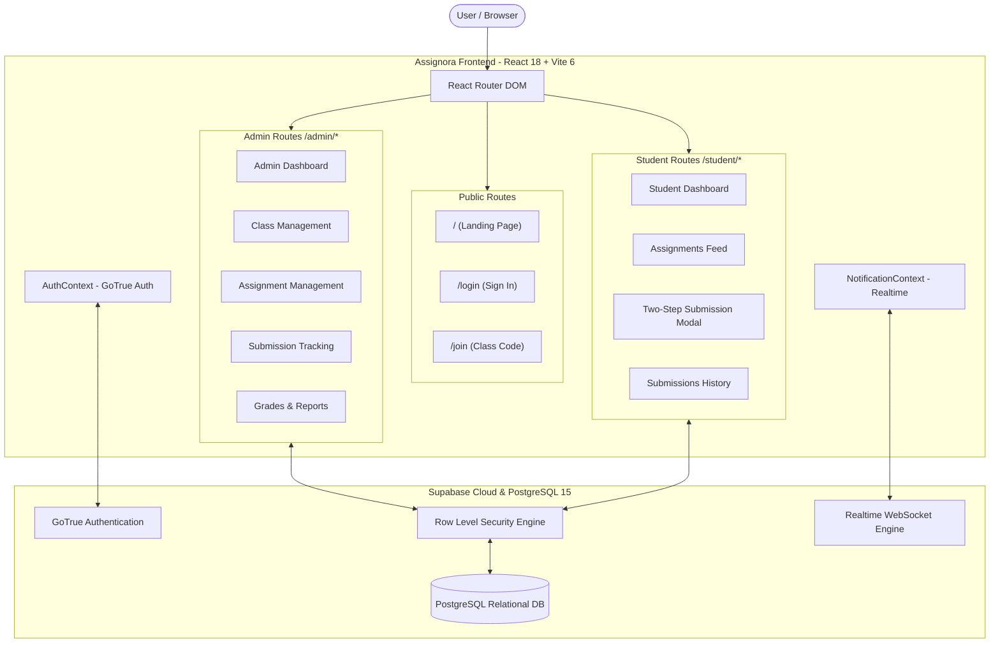
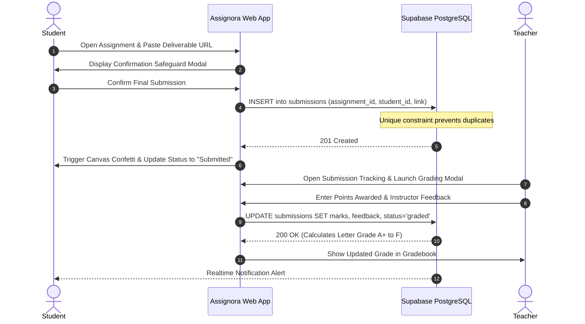

# Assignora – Smart Education Platform

[](https://react.dev/)
[](https://vitejs.dev/)
[](https://tailwindcss.com/)
[](https://supabase.com/)
[](https://reactrouter.com/)
[](https://assignora-cyan.vercel.app)
[](LICENSE)

> **Assign. Track. Achieve.**  
> An intelligent, role-isolated learning management system designed to eliminate coursework fragmentation, streamline assignment workflows, and empower educators and students through modern design.

- **Production URL**: [https://assignora-cyan.vercel.app](https://assignora-cyan.vercel.app)
- **GitHub Repository**: [https://github.com/DarshanDevadiga/assignora.git](https://github.com/DarshanDevadiga/assignora.git)

---

## Table of Contents

1. [Project Overview](#1-project-overview)
2. [Problem Statement & Objectives](#2-problem-statement--objectives)
3. [Key Features & Role Workspaces](#3-key-features--role-workspaces)
4. [Public Landing Page Showcase](#4-public-landing-page-showcase)
5. [Interface Screenshots](#5-interface-screenshots)
6. [Technology Stack](#6-technology-stack)
7. [Application Architecture](#7-application-architecture)
8. [Complete Project Folder Structure](#8-complete-project-folder-structure)
9. [Installation & Local Setup](#9-installation--local-setup)
10. [Environment Variables](#10-environment-variables)
11. [Running the Application](#11-running-the-application)
12. [Database Schema & Supabase Setup](#12-database-schema--supabase-setup)
13. [Vercel Deployment Guide](#13-vercel-deployment-guide)
14. [Security & Access Control](#14-security--access-control)
15. [Development Workflow & CI/CD](#15-development-workflow--cicd)
16. [Project Status & Roadmap](#16-project-status--roadmap)
17. [License & Contribution](#17-license--contribution)

---

## 1. Project Overview

**Assignora** is a full-stack, cloud-native educational coursework platform built with **React 18**, **Vite 6**, **Tailwind CSS 3**, and **Supabase (PostgreSQL 15)**. Drawing inspiration from Google Classroom and high-productivity SaaS tools, Assignora delivers a distinct purple-gradient visual identity (`#5B21F6`), intuitive navigation, and role-based data isolation.

The platform provides end-to-end coursework management:
- **Public Visitors**: Experience a modern SaaS landing page at `/` presenting platform benefits, interactive previews, feature breakdowns, and frictionless entry points.
- **Administrators**: Maintain global oversight of academic departments, active classrooms, faculty workloads, system-wide submissions, and compliance grade reports.
- **Teachers / Instructors**: Create classes with 6-character join codes, author assignments with deadlines and attachments, allocate tasks to whole classes or specific students, evaluate work with dynamic letter grades (`A+` to `F`), and broadcast announcements.
- **Students**: Enrol via join codes or invitations, track deadlines on personal dashboards with radial completion charts, submit deliverables via Google Drive or GitHub links with two-step confirmation, celebrate completions with confetti, and review qualitative feedback.

---

## 2. Problem Statement & Objectives

### The Problem
Traditional higher-education and K-12 coursework often suffers from:
- **Scattered Communication**: Assignments and submissions sent across unstructured email chains, WhatsApp chats, and shared folders, leading to lost files and missed deadlines.
- **Opaque Progress**: Students lack a consolidated, visual overview of upcoming versus overdue work and their cumulative completion rate.
- **Evaluation Bottlenecks**: Instructors spend hours managing disconnected spreadsheets, manual grade entry, and individual feedback emails.
- **Costly Learning Resources**: Supplemental textbooks and resources are locked behind paywalls or distributed in silos rather than integrated directly into course streams.

### Project Objectives
1. **Unified Academic Workflow**: Provide a single, centralized platform for syllabus discovery, assignment publishing, student deliverables, and evaluation.
2. **Strict Data Protection**: Enforce database-level isolation via PostgreSQL Row Level Security (RLS) so users only access authorized coursework.
3. **Frictionless Submission**: Prevent accidental submissions with a two-step confirmation modal and enforce duplicate submission locks at the database level.
4. **Motivating Feedback**: Keep students engaged with celebratory completion animations (`canvas-confetti`) and transparent grading metrics.
5. **Open Education Equity**: Embed peer-reviewed Open Educational Resources (OER) such as OpenStax and MIT OpenCourseWare directly into class resource hubs.

---

## 3. Key Features & Role Workspaces

### 🏛️ Administrator Workspace (`/admin`)
- **Executive Dashboard**: Real-time metric cards displaying total active classes, assignments, pending submissions, and overall student completion rates.
- **Class Governance**: Complete lifecycle controls for creating, inspecting, and managing digital classrooms.
- **Cross-Class Submission Tracking**: Filter submissions across all classes by status (*Submitted*, *Graded*, *Pending*, *Late*).
- **Roster & Student Directory**: Inspect enrolled students, student IDs, registration dates, and perform profile audits.
- **Gradebook & Reports**: Comprehensive gradebook with automatic letter grade computation and one-click **CSV Data Export**.

### 👩‍🏫 Teacher / Instructor Capabilities
- **Coursework Authoring**: Create assignments with rich descriptions, point values, due dates, due times, and Google Drive resource attachments.
- **Targeted Allocation**: Assign tasks to the **entire cohort** or selectively allocate work to **individual students** (ideal for remedial coursework or honors projects).
- **In-Place Evaluation Modal**: Review student deliverable links and submission notes, assign numeric marks, view calculated letter grades, and record constructive teacher feedback.
- **Classroom Announcements**: Broadcast syllabus notifications and project updates directly to enrolled student streams.
- **Dual Enrollment Controls**: Generate 6-character alphanumeric join codes or send direct modal invitations.

### 👨‍🎓 Student Workspace (`/student`)
- **Coursework Dashboard**: Personalized greeting with live statistics (*Total Assigned*, *Submitted*, *Pending*, *Overall Completion %*).
- **Radial Donut Chart**: Dynamic SVG visual breakdown illustrating coursework completion status.
- **Upcoming Assignments Feed**: Chronologically organized tasks highlighting urgent deadlines and due dates.
- **Two-Step Submission Flow**:
  1. *Step 1*: Attach deliverable URL (Google Drive, Docs, GitHub, PDF) and add optional notes.
  2. *Step 2*: Confirmation dialog to prevent premature or accidental submissions.
  3. *Celebration*: Triggers confetti animation on submission and immediately updates status to *Submitted*.
- **Duplicate Submission Lock**: Guaranteed prevention of accidental overwrites via a Postgres unique constraint on `(assignment_id, student_id)`.
- **Grade & Feedback Transparency**: View assigned marks, calculated letter grades (`A+` to `F`), and qualitative feedback notes directly on the assignment details page.

### 🔔 Real-Time Communication & Notifications
- **Real-Time Synchronization**: Instant notifications and timeline updates powered by Supabase Realtime channels.
- **Clean Subscription Teardown**: Proper channel lifecycle management via `supabase.removeChannel(channel)` to eliminate duplicate connections and memory leaks.
- **Unread Badge Indicators**: Red WhatsApp-style notification pills on header bell icons and per-class message counters.

### 📚 Open Educational Resources (OER)
Integrated direct links to peer-reviewed academic resources:
- **OpenStax**: High-quality, peer-reviewed open textbooks.
- **MIT OpenCourseWare**: Syllabus frameworks, lecture notes, and assignments.
- **Open Textbook Library**: Curated higher-education textbooks.
- **DOAB**: Directory of Open Access Books.

---

## 4. Public Landing Page Showcase

Assignora includes a public-facing landing page at `/` designed with Apple-inspired minimalism and high-contrast typography:

1. **Sticky Glassmorphism Header**: Logo, brand tagline (*"Assign. Track. Achieve."*), smooth-scroll navigation links (*Overview*, *Roles*, *Features*, *How It Works*, *Preview*), and a dynamic CTA (*"Go to Dashboard"* if authenticated, *"Sign In"* if guest).
2. **Hero Section**: High-impact headline (*"Smarter Learning. Better Teaching. One Platform."*), value subtitle, dual CTAs, and trust badges.
3. **Interactive Dashboard Preview**: High-fidelity live preview mockup of the Assignora dashboard featuring active class cards, live metric indicators, and submission badges.
4. **Role Architecture Cards**: Three dedicated cards outlining the responsibilities and workflows of Administrators, Teachers, and Students.
5. **10 Core Feature Cards**: Grid with custom icons, category badges, and hover animations covering class management, student enrollment, grading, notifications, and security.
6. **4-Step Workflow**: Connected visual progression showing *Create or Join*, *Assign Work*, *Submit Deliverables*, and *Evaluate & Track*.
7. **Interactive Preview Tabs**: Switchable UI previews showcasing the Admin Dashboard, Assignment Allocation, Student Experience, and Gradebook.
8. **Value Propositions**: Why Assignora is the ideal choice for modern educational institutions.
9. **Conversion CTA & Footer**: High-conversion footer section with navigation shortcuts, tech stack badges, and dynamic copyright year.

---

## 5. Interface Screenshots

> *To update screenshots, place your PNG images in the `docs/screenshots/` directory using the filenames below.*

| View | Preview |
| :--- | :--- |
| **Public Landing Page** | `docs/screenshots/landing-page.png` |
| **Admin Dashboard** | `docs/screenshots/admin-dashboard.png` |
| **Class Detail & Assignments** | `docs/screenshots/class-detail.png` |
| **Student Dashboard & Donut** | `docs/screenshots/student-dashboard.png` |
| **Two-Step Submission Modal** | `docs/screenshots/submission-modal.png` |
| **Grading & Evaluation Modal** | `docs/screenshots/grading-modal.png` |

---

## 6. Technology Stack

### Frontend Core
- **React (`18.3.1`)**: Component-based UI architecture with hooks and concurrent rendering.
- **Vite (`6.0.7`)**: Ultra-fast build tool and development server with Rollup production bundling.
- **React Router DOM (`7.18.5`)**: Declarative client-side routing with nested layouts and role guards.
- **Tailwind CSS (`3.4.17`)**: Utility-first CSS framework customized with Assignora design tokens.
- **PostCSS (`8.5.1`) & Autoprefixer (`10.4.20`)**: CSS processing and vendor prefixing.

### Backend, Database & Cloud
- **Supabase JS Client (`2.49.1`)**: Official SDK for PostgreSQL database queries, GoTrue authentication, and Realtime websocket channels.
- **PostgreSQL 15**: Relational database engine with Row Level Security (RLS) policies.
- **Vercel**: Edge deployment platform configured with SPA routing rules (`vercel.json`).

### UI Atoms & Visual Enhancements
- **Lucide React (`1.16.0`)**: Modern, consistent SVG icon set.
- **Canvas Confetti (`1.9.4`)**: High-performance celebratory particle effects for student submissions.
- **Clsx (`2.1.1`) & Tailwind Merge (`2.6.0`)**: Conditional class name composition without style conflicts.

---

## 7. Application Architecture

### System Architecture Diagram



### Two-Step Submission & Evaluation Sequence



### Route Routing Table

| Route Path | Access Level | Component | Purpose |
| :--- | :--- | :--- | :--- |
| `/` | Public | `LandingPage.jsx` | Public SaaS landing page & platform presentation |
| `/login` | Public (Guest) | `Login.jsx` | Universal sign-in (redirects to dashboard if logged in) |
| `/dashboard` | Protected | Redirect | Redirects to `/admin` or `/student` based on user role |
| `/join` | Public / Student | `JoinClassPage.jsx` | Join a classroom via 6-character code |
| `/invite` | Public / Student | `JoinClassPage.jsx` | Direct classroom invitation link handler |
| `/admin` | Admin Role | `AdminDashboard.jsx` | Administrator overview metrics & live cards |
| `/admin/classes` | Admin Role | `ClassesManagement.jsx` | Classroom creation & class cards grid |
| `/admin/classes/:id` | Admin Role | `ClassDetailPage.jsx` | 5-tab class workspace (Overview, Work, People, Messages, OER) |
| `/admin/assignments` | Admin Role | `AssignmentsList.jsx` | Assignment management & submission counters |
| `/admin/assignments/create` | Admin Role | `CreateAssignment.jsx` | Assignment authoring (cohort or targeted students) |
| `/admin/assignments/:id` | Admin Role | `SubmissionTracking.jsx` | Student-wise submissions & grading modal |
| `/admin/grades` | Admin Role | `GradesGradebook.jsx` | Gradebook, letter grades, and CSV export |
| `/admin/students` | Admin Role | `StudentsManagement.jsx` | Institutional student directory |
| `/student` | Student Role | `StudentDashboard.jsx` | Coursework dashboard, radial chart & classes |
| `/student/assignments/:id` | Student Role | `AssignmentDetails.jsx` | Assignment instructions, resource links & submission |
| `/student/submissions` | Student Role | `StudentSubmissions.jsx` | Historical record of submitted work and grades |
| `/student/announcements` | Student Role | `StudentAnnouncements.jsx`| Published class notices & updates |
| `*` | Catch-all | `NotFound.jsx` | Clean 404 page with navigation redirect |

---

## 8. Complete Project Folder Structure

```
assignora/
├── .env.example                          # Environment variable configuration template
├── .gitignore                            # Git ignore specifications (secrets, references)
├── index.html                            # HTML5 root document
├── LICENSE                               # MIT License file
├── package.json                          # Dependencies, scripts and package metadata
├── package-lock.json                     # Deterministic dependency lockfile
├── postcss.config.js                     # PostCSS Tailwind & Autoprefixer configuration
├── README.md                             # Comprehensive project documentation
├── tailwind.config.js                    # Custom colors, border-radii, and design tokens
├── vercel.json                           # Vercel Single-Page Application rewrites
├── vite.config.js                        # Vite bundler options & Rollup code-splitting chunks
├── scripts/                              # Academic seed and verification scripts
│   ├── seed-academic-demo-data.js        # Realistic demo classes, assignments, and topics
│   ├── seed-submissions.js               # Submission seeding and sample grading records
│   └── verify-all-10-scenarios.js        # Automated test suite for academic calculations
└── src/
    ├── App.jsx                           # Application root provider wrapper
    ├── index.css                         # Global CSS styles & Tailwind directives
    ├── main.jsx                          # React DOM client entry point
    ├── components/
    │   ├── admin/
    │   │   └── StudentSelectionModal.jsx # Selective student allocation selector
    │   ├── class/
    │   │   ├── InviteStudentModal.jsx    # Direct student invitation modal
    │   │   ├── JoinClassModal.jsx        # Modal for entering 6-character class code
    │   │   └── StudentProfileModal.jsx   # Profile viewer modal for instructors
    │   ├── common/
    │   │   ├── Badge.jsx                 # Status badge atom (Submitted, Graded, Pending, Late)
    │   │   ├── Button.jsx                # Brand-styled action buttons
    │   │   ├── Card.jsx                  # Standardized container card with soft border
    │   │   ├── ErrorBoundary.jsx         # React error boundary component
    │   │   ├── Input.jsx                 # Accessible form input field
    │   │   ├── Modal.jsx                 # Accessible modal dialog container
    │   │   ├── NotificationBadge.jsx     # Unread notification pill badge
    │   │   ├── NotificationsDrawer.jsx   # Slide-out notification history drawer
    │   │   ├── ProgressBar.jsx           # Animated completion progress bar
    │   │   ├── SearchInput.jsx           # Search input with clear button
    │   │   └── StatCard.jsx              # Metric card with icons and trends
    │   ├── layout/
    │   │   ├── DashboardLayout.jsx       # Persistent responsive application shell
    │   │   ├── Header.jsx                # Top app bar with search, notifications & avatar
    │   │   ├── MobileNav.jsx             # Mobile drawer navigation menu
    │   │   └── Sidebar.jsx               # Desktop sidebar with role-specific navigation
    │   └── student/
    │       └── TwoStepSubmissionModal.jsx# Two-step deliverable submission dialog
    ├── context/
    │   ├── AuthContext.jsx               # GoTrue auth session, user profile & sign-in/out
    │   └── NotificationContext.jsx       # Realtime notifications & channel cleanup
    ├── hooks/
    │   └── useAuth.js                    # Convenience hook for authentication state
    ├── lib/
    │   └── supabase.js                   # Supabase client instantiation & URL sanitizer
    ├── pages/
    │   ├── LandingPage.jsx               # Public Apple-inspired SaaS landing page
    │   ├── Login.jsx                     # Universal authentication portal
    │   ├── admin/
    │   │   ├── AdminDashboard.jsx        # Executive administrator dashboard
    │   │   ├── AnnouncementsManagement.jsx# Formal announcement authoring
    │   │   ├── AssignmentsList.jsx       # Assignment cards with submission metrics
    │   │   ├── ClassesManagement.jsx     # Class directory and creation controls
    │   │   ├── CreateAssignment.jsx      # Assignment creation & targeting form
    │   │   ├── GradesGradebook.jsx       # Consolidated student gradebook & CSV export
    │   │   ├── StudentsManagement.jsx    # Institutional student directory
    │   │   └── SubmissionTracking.jsx    # Submissions review and grading workspace
    │   ├── shared/
    │   │   ├── ClassDetailPage.jsx       # 5-tab classroom workspace
    │   │   ├── JoinClassPage.jsx         # Standalone class code redemption page
    │   │   ├── NotFound.jsx              # 404 error page with navigation shortcuts
    │   │   ├── ProfilePage.jsx           # User profile and password management
    │   │   └── SettingsPage.jsx          # User preferences and appearance settings
    │   └── student/
    │       ├── AssignmentDetails.jsx     # Detailed assignment brief & submit button
    │       ├── StudentAnnouncements.jsx  # Student view of broadcasted class notices
    │       ├── StudentDashboard.jsx      # Student coursework hub & radial donut chart
    │       └── StudentSubmissions.jsx    # Personal submitted deliverables and grades
    ├── routes/
    │   ├── AppRoutes.jsx                 # Complete route tree and lazy component mapping
    │   ├── ProtectedRoute.jsx            # Authentication gatekeeper
    │   └── RoleRoute.jsx                 # Role enforcement gatekeeper (`admin` vs `student`)
    ├── services/
    │   ├── announcements.service.js      # Class announcement queries and mutations
    │   ├── assignments.service.js        # Assignment CRUD and student targeting queries
    │   ├── auth.service.js               # GoTrue session management and profile queries
    │   ├── classes.service.js            # Classroom creation, membership, and OER links
    │   ├── messages.service.js           # Class discussion stream messages
    │   ├── notifications.service.js      # Notification event records and read receipts
    │   ├── submissions.service.js        # Deliverable submission, evaluation and marks
    │   └── users.service.js              # Student roster and user profile lookups
    └── utils/
        └── calculations.js               # Standardized letter grade and percentage helpers
```

---

## 9. Installation & Local Setup

### Prerequisites
- **Node.js**: `v18.0.0` or later (tested on Node `20.x` and `22.x`)
- **npm**: `v9.0.0` or later
- A free **Supabase** project with GoTrue Auth and PostgreSQL 15.

### Step-by-Step Instructions

1. **Clone the repository:**
   ```bash
   git clone https://github.com/DarshanDevadiga/assignora.git
   cd assignora
   ```

2. **Configure environment variables:**
   Create a local `.env` file from the provided `.env.example`:
   ```bash
   cp .env.example .env
   ```

3. **Install project dependencies:**
   ```bash
   npm install
   ```

4. **Start the local development server:**
   ```bash
   npm run dev
   ```
   Open your browser and navigate to `http://localhost:5173`.

---

## 10. Environment Variables

Assignora requires two Supabase client credentials. Add these to your `.env` file for local development, and configure them under the **Environment Variables** tab in your Vercel project dashboard.

| Variable Name | Required | Description | Example / Placeholder |
| :--- | :---: | :--- | :--- |
| `VITE_SUPABASE_URL` | **Yes** | Your Supabase Project API URL | `https://your-project-id.supabase.co` |
| `VITE_SUPABASE_PUBLISHABLE_KEY` | **Yes** | Public publishable / anon API key | `eyJhbGciOiJIUzI1NiIsInR5c...` |
| `VITE_SUPABASE_ANON_KEY` | Optional | Alias for publishable key | `eyJhbGciOiJIUzI1NiIsInR5c...` |

> [!IMPORTANT]
> Never commit actual credentials, service role keys, or production secrets to Git. The root `.gitignore` excludes `.env` and `.env.*` files automatically.

---

## 11. Running the Application

### Development Mode
```bash
npm run dev
```
Starts the Vite development server with instant Hot Module Replacement (HMR) at `http://localhost:5173`.

### Production Build
```bash
npm run build
```
Compiles and minifies all assets into the `dist/` directory. Rollup performs vendor chunk-splitting for optimized caching and fast initial page loads.

### Preview Production Build
```bash
npm run preview
```
Serves the compiled production bundle locally at `http://localhost:4173` to test production performance and routing before deployment.

---

## 12. Database Schema & Supabase Setup

Assignora is backed by 8 relational PostgreSQL tables managed via Supabase:

### Entity-Relationship Diagram


### Table Schema Summary

1. **`users`**: User profile information linked to GoTrue auth IDs (`id`, `name`, `email`, `role`, `avatar`, `student_id`, `created_at`).
2. **`classes`**: Digital classrooms (`id`, `name`, `subject`, `description`, `code`, `admin_id`, `created_at`).
3. **`class_members`**: Classroom student enrollment records (`id`, `class_id`, `student_id`, `joined_at`).
4. **`assignments`**: Coursework tasks and deadlines (`id`, `title`, `description`, `class_id`, `admin_id`, `due_date`, `due_time`, `points`, `drive_link`, `assign_to_all`, `status`, `created_at`).
5. **`assignment_students`**: Targeted assignment mappings for selective allocations (`id`, `assignment_id`, `student_id`, `assigned_at`).
6. **`submissions`**: Student deliverables and evaluation marks (`id`, `assignment_id`, `student_id`, `submission_link`, `comment`, `status`, `marks`, `feedback`, `submitted_at`, `updated_at`). Enforces a **UNIQUE constraint** on `(assignment_id, student_id)`.
7. **`announcements`**: Broadcasted class notices (`id`, `title`, `message`, `admin_id`, `class_id`, `is_published`, `created_at`).
8. **`notifications`**: User alerts (`id`, `user_id`, `title`, `message`, `type`, `reference_id`, `is_read`, `created_at`).

### Row Level Security (RLS) Policies
- **Role Enforcement**: User role (`admin` vs `student`) is queried directly from `public.users` upon authentication, preventing unauthorized role elevation.
- **Assignment Access**: Students can only view assignments for classes they are enrolled in and assignments assigned to them.
- **Submission Protection**: Students can only insert and read their own submissions. Instructors can view and update submissions for assignments belonging to classes they own.

### Supabase Realtime & Subscription Teardown
To prevent memory leaks and zombie WebSocket connections during React StrictMode re-renders:
```javascript
// Clean channel teardown in useEffect
useEffect(() => {
  if (!user?.id) return

  const channel = supabase
    .channel(`user-notifications-${user.id}`)
    .on('postgres_changes', { event: 'INSERT', schema: 'public', table: 'notifications' }, handleNotification)
    .subscribe()

  return () => {
    supabase.removeChannel(channel)
  }
}, [user?.id])
```

---

## 13. Vercel Deployment Guide

Assignora is deployed as a single-page application on **Vercel**:

- **Production URL**: [https://assignora-cyan.vercel.app](https://assignora-cyan.vercel.app)

### Deployment Steps
1. Push your repository to GitHub: `https://github.com/DarshanDevadiga/assignora.git`.
2. In the [Vercel Dashboard](https://vercel.com), click **Add New Project** and import the `assignora` repository.
3. Configure project settings:
   - **Framework Preset**: `Vite`
   - **Build Command**: `npm run build`
   - **Output Directory**: `dist`
   - **Install Command**: `npm install`
4. Under **Environment Variables**, add:
   - `VITE_SUPABASE_URL`: `https://your-project-id.supabase.co`
   - `VITE_SUPABASE_PUBLISHABLE_KEY`: `your_supabase_publishable_anon_key`
5. Click **Deploy**. Vercel will build the project and issue a live URL.

### Single-Page Application (SPA) Rewrites
To ensure deep links (e.g. `/admin/classes`, `/student/submissions`) resolve correctly on page refresh, `vercel.json` provides URL rewrites to `/index.html`:
```json
{
  "rewrites": [
    { "source": "/(.*)", "destination": "/index.html" }
  ]
}
```

---

## 14. Security & Access Control

Assignora implements defense-in-depth security principles:

1. **PostgreSQL Row Level Security (RLS)**: Enforces table-level read and write policies in the database, ensuring queries cannot leak data across institutional boundaries.
2. **Server-Verified Roles**: The application verifies user roles against the `public.users` table rather than trusting client-side claims or mutable storage.
3. **Safe Secrets Management**: Sensitive credentials are never hardcoded. All keys are loaded through Vite environment variables (`import.meta.env`).
4. **URL Sanitization**: Supabase connection URLs are trimmed and validated before client initialization to prevent malformed requests.
5. **Git Tracking Safeguards**: The `.gitignore` file strictly blocks `.env`, `.env.*`, and reference mockup folders from being committed.

---

## 15. Development Workflow & CI/CD

- **Version Control**: GitHub repository using the `main` branch as the stable release trunk.
- **Automated Deployments**: Vercel Git integration triggers an automated production build and deployment upon every commit pushed to `main`.
- **Code Splitting**: Rollup `manualChunks` in `vite.config.js` separates large libraries (`vendor`, `supabase`, `icons`) into independent cacheable chunks, ensuring sub-second route transitions.

---

## 16. Project Status & Roadmap

### ✅ Implemented & Verified in Production
- [x] Public SaaS Landing Page (`/`) with responsive navigation and preview showcase.
- [x] Unified `/dashboard` role-based redirect handler.
- [x] Full Admin & Teacher workspace with class, assignment, and grading controls.
- [x] Full Student workspace with radial donut progress charts and submissions.
- [x] Two-step submission confirmation flow with confetti celebration.
- [x] Dynamic letter grading (`A+` to `F`) with qualitative instructor feedback.
- [x] Real-time notification counters with proper channel cleanup.
- [x] Five realistic demo classes seeded with academic curricula and OER links.
- [x] Vercel SPA routing and automated CI/CD pipeline.

### 🔮 Planned Future Enhancements
- [ ] Direct deliverable file uploads to Supabase Storage buckets.
- [ ] Automated plagiarism detection check via external academic API.
- [ ] Browser Web Push notifications for immediate deadline alerts.
- [ ] In-browser PDF deliverable annotation and inline markup.
- [ ] Multi-criteria rubric grading builder.

---

## 17. License & Contribution

This project is licensed under the **MIT License** — see the [LICENSE](LICENSE) file for details.

### Contributing
Contributions, bug reports, and feature suggestions are welcome!
1. Fork the repository.
2. Create a feature branch (`git checkout -b feature/amazing-feature`).
3. Commit your changes (`git commit -m "Add amazing feature"`).
4. Push to the branch (`git push origin feature/amazing-feature`).
5. Open a Pull Request.

---

<p align="center">
  <strong>Assignora – Smart Education Platform</strong><br>
  <em>Assign. Track. Achieve.</em>
</p>
