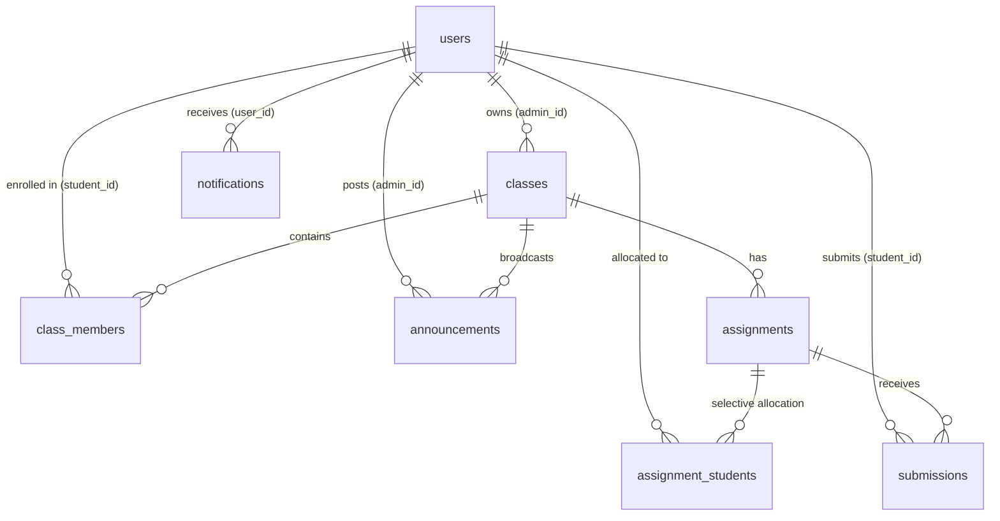

# Assignora — Assign. Track. Achieve.

> **Production-Quality Educational Assignment & Academic Workflow Management Platform**  
> *Developed for the Joineazy Frontend Development Assignment*

---

## 📖 1. Project Overview

**Assignora** is a modern, responsive educational assignment and academic workflow management SaaS platform designed for professors, administrators, and students. Inspired by Google Classroom with a sleek modern design system, Assignora streamlines coursework allocation, external submission tracking via Google Drive/GitHub, class roster management, stream announcements, and dynamic completion analytics.

The platform provides strictly separated, role-based experiences:
- **Admin / Professor**: Full class lifecycle management, assignment creation (whole-class or selective student allocations), deadlines and points configuration, real-time submission tracking, student-wise status grids, gradebook analytics, and CSV exports.
- **Student**: Google Classroom-inspired dashboard, enrolled courses overview, actionable assignment lists, two-step confirmation submission workflow, duplicate submission prevention, and personal progress tracking.

---

## 🎨 2. Approved Brand Identity & Design Tokens

Assignora follows a strict, elegant design system:

| Token Name | Hex Code | Visual Application |
| :--- | :--- | :--- |
| **Primary Purple** | `#5B21F6` | Primary action buttons, active tab indicators, brand accents |
| **Primary Hover** | `#4C1D95` | Button hover and pressed states |
| **Secondary Purple** | `#8B5CF6` | Sub-headers, secondary badges, illustrations |
| **Light Purple** | `#EDE9FE` | Subtle container backgrounds, avatar rings |
| **Active Navigation** | `#F1EDFF` | Active sidebar nav pill background |
| **Purple Border** | `#DDD6FE` | Accent card borders |
| **App Canvas** | `#F8F9FF` | Main application background |
| **Secondary Canvas** | `#F5F3FF` | Card gradients and secondary sections |
| **Surface White** | `#FFFFFF` | Cards, sidebars, modals, headers |
| **Headings** | `#111827` | Primary high-contrast text |
| **Body** | `#374151` | Standard readable paragraph text |
| **Muted** | `#64748B` | Labels, timestamps, placeholders |
| **Success** | `#16A34A` | Submitted badges, positive progress |
| **Warning** | `#F59E0B` | Pending submissions, due soon badges |
| **Danger** | `#EF4444` | Overdue deadlines, unsubmitted alerts |

- **Typography**: Inter (Headings: 600–700, Body: 400, Buttons: 500–600)
- **Geometry**: Cards: `14px` border-radius (`rounded-card`), Form inputs & buttons: `9px` radius, subtle shadows (`0 1px 3px rgba(0,0,0,0.05)`).

---

## ✨ 3. Core Features & Joineazy Requirements

### 🔐 Authentication & Role-Based Access
- Email and password authentication powered by **Supabase GoTrue Auth**.
- Strict database-backed role validation (roles are read directly from `public.users` in Postgres, never trusted from client-side `localStorage`).
- Pre-seeded quick-select demo accounts with instant auto-fill and validation.
- Persistent sessions across browser refreshes and tab reloads.
- Role-isolated routing (`/admin/*` vs. `/student/*`) with automatic redirect guards.

### 👩‍🏫 Admin / Professor Workspace
- **Dynamic Executive Dashboard**: Greeting banner, current date indicator, and 4 real-time metric cards (*Classes, Assignments, Submissions, Avg. Completion Rate*).
- **Class Stream & Hero Banner**: Course details (*MCA – Semester 5*), enrolled student counters, and in-place announcement composer.
- **My Classes Management**: Google Classroom-style grid cards with distinct gradient banners, course CRUD modals, and cascading deletion.
- **Student Roster Management**: Class roster table, student search, enrollment dialog for available student accounts, and unenrollment safeguards.
- **Assignment Creation & Allocation**: Rich description editor, Google Drive link resource attachment, due date/time pickers, points weighting, and **Assign to All** vs. **Select Students** modal.
- **Submissions Tracking**: Student-by-student submission status (*Submitted, Pending, Not Submitted*), deliverable link viewer, student notes inspector, dynamic completion progress bar (`(Submitted / Assigned) × 100`), status filtering, search, and one-click **CSV Data Export**.
- **Class Gradebook**: Matrix view of all assignment scores per student, overall point totals, dynamic letter grades (`A+` to `F`), and CSV export.

### 👨‍🎓 Student Dashboard & Workflow
- **Google Classroom-Inspired Home**: Welcome banner with 3D academic illustration, 4 live progress cards (*Total Assigned, Submitted, Pending, Completion Rate*).
- **Radial Donut Progress Chart**: Visual SVG donut chart showing personal completion percentage with categorized legends.
- **My Assignments Feed**: Actionable assignment cards with course badges, deadline countdowns, external Google Drive resources, and direct `[Submit]` actions.
- **Two-Step Submission Confirmation**:
  1. *Step 1*: Attach deliverable link (Drive/GitHub/Vercel) & notes → Click *"Yes, I have submitted"* → Modal dialog opens.
  2. *Step 2*: Final confirmation dialog → Inserts submission record to Supabase → Triggers celebratory confetti (`canvas-confetti`) → Immediately locks form and updates status to *Submitted*.
- **Duplicate Submission Guard**: Hard prevention both in UI and backed by Postgres database unique constraint on `(assignment_id, student_id)`.
- **My Submissions**: Comprehensive archive of all student deliverables with timestamps and external link access.

---

## 🛠️ 4. Technology Stack

- **Frontend Framework**: React 18
- **Build Tool & Bundler**: Vite 6 (with Rollup manual chunks code-splitting)
- **Styling**: Tailwind CSS 3 & PostCSS
- **Routing**: React Router DOM 6
- **Database & Auth**: Supabase (PostgreSQL, GoTrue Auth, REST API, Row Level Security)
- **Icons**: Lucide React
- **Animations & Effects**: Canvas Confetti

---

## 🗄️ 5. Database Architecture & Schema

The platform connects to Supabase PostgreSQL at `https://trkcagoxopabqerljgvn.supabase.co` with 8 relational tables and Row Level Security (RLS):



### Table Definitions:
1. `users`: `id` (uuid, PK), `name` (text), `email` (text), `role` (`admin` | `student`), `avatar` (text), `student_id` (text), `created_at` (timestamptz).
2. `classes`: `id` (uuid, PK), `name` (text), `subject` (text), `description` (text), `admin_id` (uuid, FK users.id), `created_at` (timestamptz).
3. `class_members`: `id` (uuid, PK), `class_id` (uuid, FK classes.id), `student_id` (uuid, FK users.id), `joined_at` (timestamptz).
4. `assignments`: `id` (uuid, PK), `title` (text), `description` (text), `class_id` (uuid, FK classes.id), `admin_id` (uuid, FK users.id), `due_date` (date), `due_time` (time), `drive_link` (text), `points` (numeric), `assign_to_all` (boolean), `status` (text), `created_at`, `updated_at`.
5. `assignment_students`: `id` (uuid, PK), `assignment_id` (uuid, FK assignments.id), `student_id` (uuid, FK users.id), `assigned_at` (timestamptz).
6. `submissions`: `id` (uuid, PK), `assignment_id` (uuid, FK assignments.id), `student_id` (uuid, FK users.id), `submission_link` (text), `comment` (text), `status` (text), `submitted_at`, `updated_at`. *Unique constraint on `(assignment_id, student_id)`*.
7. `announcements`: `id` (uuid, PK), `title` (text), `message` (text), `admin_id` (uuid, FK users.id), `class_id` (uuid, FK classes.id), `is_published` (boolean), `created_at`, `updated_at`.
8. `notifications`: `id` (uuid, PK), `user_id` (uuid, FK users.id), `title` (text), `message` (text), `type` (text), `reference_id` (text), `is_read` (boolean), `created_at` (timestamptz).

---

## 👥 6. Pre-Seeded Demo Accounts

The application includes seven pre-configured demo accounts. You can select them directly from the login dropdown or enter their credentials:

| Role | Name | Email | Password |
| :--- | :--- | :--- | :--- |
| **Admin 1** | Administrator | `admin@assignora.demo` | `Admin@12345` |
| **Admin 2** | Professor Admin | `professor@assignora.demo` | `Professor@123` |
| **Student 1** | Student 1 (John Doe) | `student1@assignora.demo` | `Student@123` |
| **Student 2** | Student 2 (Jane Smith) | `student2@assignora.demo` | `Student@123` |
| **Student 3** | Student 3 (Alex Johnson) | `student3@assignora.demo` | `Student@123` |
| **Student 4** | Student 4 (Sneha Rao) | `student4@assignora.demo` | `Student@123` |
| **Student 5** | Student 5 (Rahul Sharma) | `student5@assignora.demo` | `Student@123` |

---

## 🚀 7. Local Installation & Development

### Prerequisites
- Node.js `v18+` or `v20+` (tested on `v24.16.0`)
- npm `v9+` (tested on `12.2.0`)

### Setup Instructions
1. **Clone the repository:**
   ```bash
   git clone <repository-url>
   cd assignora
   ```

2. **Configure Environment Variables:**
   Copy `.env.example` to `.env`:
   ```bash
   cp .env.example .env
   ```
   Ensure `.env` contains:
   ```env
   VITE_SUPABASE_URL=https://trkcagoxopabqerljgvn.supabase.co
   VITE_SUPABASE_PUBLISHABLE_KEY=your_supabase_publishable_anon_key_here
   ```

3. **Install Dependencies:**
   ```bash
   npm install
   ```

4. **Start Development Server:**
   ```bash
   npm run dev
   ```
   Open `http://localhost:5173` in your browser.

5. **Build for Production:**
   ```bash
   npm run build
   ```

---

## 🌐 8. Deployment Instructions (Vercel)

Assignora includes a pre-configured `vercel.json` for single-page application client routing.

### To Deploy on Vercel:
1. Push your repository to GitHub.
2. Go to [Vercel](https://vercel.com) and click **"Add New Project"**.
3. Import your `assignora` repository.
4. Set the Framework Preset to **Vite**.
5. In the **Environment Variables** section, add:
   - `VITE_SUPABASE_URL`: `https://trkcagoxopabqerljgvn.supabase.co`
   - `VITE_SUPABASE_PUBLISHABLE_KEY`: *(Your Supabase publishable anon key)*
6. Click **Deploy**. Vercel will bundle the optimized application and assign a live production URL.

---

## 🔒 9. Security & Architecture Considerations

- **Row Level Security (RLS)**: Enforced on all tables in Supabase Postgres. Admin 2 cannot read or modify Admin 1's classes or assignments. Students can only view coursework assigned to their classes or allocated to them directly, and cannot view or tamper with other students' submissions.
- **Client-Side Sanitization**: `src/lib/supabase.js` validates credentials and sanitizes base URLs, stripping trailing `/rest/v1` routes automatically.
- **Transaction Rollback Protection**: For multi-table writes (such as creating an assignment with selected students in `assignment_students`), `assignments.service.js` performs defensive rollbacks if a partial insert fails, preventing orphaned records.
- **Strict Role Verification**: Role state is fetched directly from `public.users` in Postgres upon GoTrue token authentication, completely eliminating client-side localStorage privilege escalation.
- **Zero Secrets in Git**: Sensitive credentials and `.env` files are strictly excluded via `.gitignore`.
