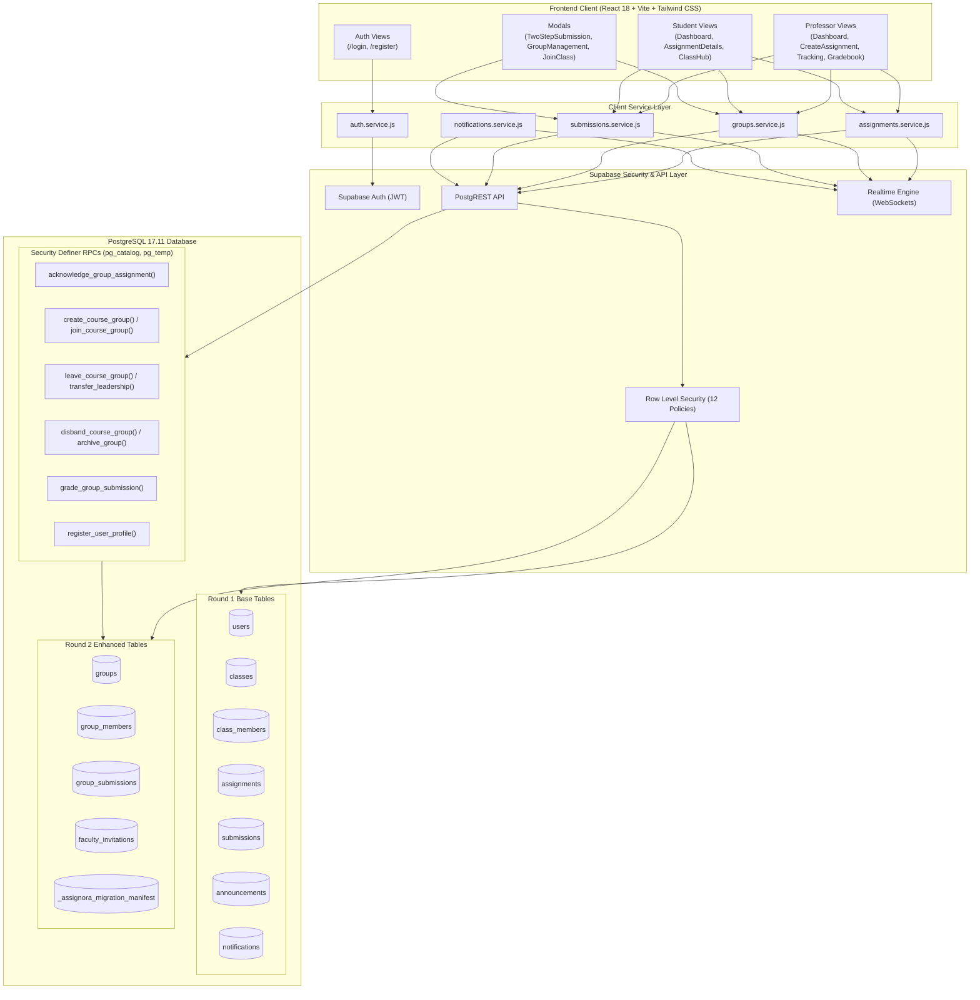

# Assignora – Student, Group & Assignment Management

[](https://react.dev/)
[](https://vitejs.dev/)
[](https://tailwindcss.com/)
[](https://supabase.com/)
[](https://reactrouter.com/)
[](https://assignora-cyan.vercel.app)
[](LICENSE)

> **Assign. Track. Achieve.**  
> An enterprise-grade, role-isolated academic management platform engineered with modern React, Tailwind CSS, and cloud-native Supabase PostgreSQL. Designed to eliminate coursework fragmentation, streamline assignment workflows, and provide end-to-end transparency for educators and students.

- **Production Application URL**: [https://assignora-cyan.vercel.app](https://assignora-cyan.vercel.app)
- **Official GitHub Repository**: [https://github.com/DarshanDevadiga/assignora](https://github.com/DarshanDevadiga/assignora)
- **Target Database Instance**: `trkcagoxopabqerljgvn` (PostgreSQL 17.11 on Supabase, AWS ap-southeast-1)

---

## Table of Contents

1. [Project Overview](#1-project-overview)
2. [Technology Stack](#2-technology-stack)
3. [Task 1 – Round 1: Initial Application Development](#3-task-1--round-1-initial-application-development)
4. [Task 2 – Round 2: Student, Group & Assignment Management – UI/UX Enhancement](#4-task-2--round-2-student-group--assignment-management--uiux-enhancement)
5. [Task 1 vs Task 2 Comparison](#5-task-1-vs-task-2-comparison)
6. [System Architecture](#6-system-architecture)
7. [Database Schema](#7-database-schema)
8. [Project Folder Structure](#8-project-folder-structure)
9. [Installation and Setup](#9-installation-and-setup)
10. [Environment Variables](#10-environment-variables)
11. [Demo Login Details](#11-demo-login-details)
12. [Feature Completion Checklist](#12-feature-completion-checklist)
13. [Testing & Quality Verification](#13-testing--quality-verification)
14. [Screenshots and Interface Walkthrough](#14-screenshots-and-interface-walkthrough)
15. [Deployment](#15-deployment)
16. [Demo Video](#16-demo-video)
17. [Official Submission Requirements](#17-official-submission-requirements)

---

## 1. Project Overview

**Assignora** is an academic coursework and assignment tracking platform tailored for colleges and universities. It bridges the gap between instructors and students by providing role-specific dashboards, frictionless submission workflows, and real-time collaboration tools.

### Core Value Proposition
- **Dual Workspace Isolation**: Strict role segregation between **Professor** (course creation, assignment authoring, grading, student management) and **Student** (coursework feeds, deadlines, submission acknowledgements, team collaboration).
- **Academic Integrity by Architecture**: Duplicate submission locks, immutable submission records, and audit-logged grading backed by PostgreSQL engine constraints and Row Level Security (RLS).
- **Design Excellence**: Consistent purple-gradient visual identity (`#5B21F6` primary, `#8B5CF6` secondary, `#EDE9FE` accent, `#F8F9FF` background), Inter typography, accessible form controls, and fully responsive layouts across mobile, tablet, and desktop screens.

---

## 2. Technology Stack

### Frontend Architecture
- **Core Library**: [React 18.3.1](https://react.dev/) (Hooks, Context API, Suspense with route-level code splitting)
- **Build Tooling**: [Vite 6.0.7](https://vitejs.dev/) with Fast Refresh and chunk optimization
- **Routing**: [React Router DOM 7.18.5](https://reactrouter.com/) (Role-based guards, protected routes, dynamic redirect paths)
- **Styling**: [Tailwind CSS 3.4.17](https://tailwindcss.com/) with `@tailwindcss/forms` and custom design tokens
- **Icons**: [Lucide React 1.16.0](https://lucide.dev/) (Semantic SVG icons throughout)
- **Visual Feedback**: [canvas-confetti 1.9.4](https://www.kirilv.com/canvas-confetti/) for submission celebration

### Backend & Cloud Infrastructure
- **Database Engine**: [PostgreSQL 17.11](https://www.postgresql.org/) managed via Supabase (AWS ap-southeast-1)
- **Authentication**: Supabase Auth (JWT session management, local persistence, auto-refresh)
- **Real-Time Engine**: Supabase Realtime (PostgreSQL replication publication over WebSockets)
- **Hosting & CI/CD**: [Vercel](https://vercel.com/) (Production deployment linked directly to GitHub repository)

---

## 3. Task 1 – Round 1: Initial Application Development

In Round 1, the foundational prototype for Assignora was established to prove full-stack feasibility, data isolation, and core academic workflows.

### Objectives & Delivered Scope
1. **Authentication & Session Persistence**:
   - Email/password authentication integrated with Supabase Auth.
   - User profile storage in `public.users` storing roles (`student`, `admin`), student IDs, and registration metadata.
   - Protected routes preventing unauthenticated access; automatic redirect to role dashboard upon sign-in.
2. **Course / Classroom Governance**:
   - Instructors create digital classrooms (`public.classes`) with unique 6-character alphanumeric join codes.
   - Dual enrollment: Students join classes via join codes or direct instructor invitations (`public.class_members`).
3. **Coursework Authoring & Targeted Allocation**:
   - Assignment authoring with title, rich description, points (marks), due dates, and reference links (`public.assignments`).
   - Selective assignment allocation: Cohort-wide assignment (`assign_to_all = true`) or selective assignment to designated students (`public.assignment_students`).
4. **Individual Deliverable Submissions**:
   - Students attach deliverable links (Google Drive, GitHub, PDF) with optional student notes (`public.submissions`).
   - Two-step confirmation dialog preventing accidental submissions.
   - Database unique constraint on `(assignment_id, student_id)` preventing duplicate overwrites.
5. **Classroom Announcements & Real-Time Sync**:
   - Course instructors broadcast syllabus updates and announcements (`public.announcements`).
   - Real-time notification channel synchronization via Supabase WebSockets.
6. **Classroom Messaging**:
   - Course-scoped live messaging channel (`public.class_messages`) with automatic unread counters.
7. **Round 1 Database Structure**:
   - 9 baseline tables: `users`, `classes`, `class_members`, `assignments`, `assignment_students`, `submissions`, `announcements`, `notifications`, `class_messages`.
   - Row Level Security (RLS) active on all 9 tables.

---

## 4. Task 2 – Round 2: Student, Group & Assignment Management – UI/UX Enhancement

Round 2 elevates Assignora from a working prototype into an intuitive, polished product with collaborative group assignments, OneDrive reference materials, and comprehensive submission tracking.

### 4.1 Authentication & Registration Improvements
- **Dual Role Registration (`/register`)**: New users select their role—**Student** or **Professor**—during registration.
- **Form Validation & Polish**: Real-time error handling, password length enforcement (minimum 6 characters), email syntax validation, and password visibility toggle.
- **Role-Based Redirects**: Students are directed to `/student`; professors are directed to `/admin`.
- **JWT Session Integrity**: Full session persistence across page refreshes via Supabase Auth and token storage; explicit logout clears session and redirects to `/login`.
- **Quick Demo Account Fillers**: One-click demo credential pills on `/login` allowing instant testing of both Professor and Student accounts.

### 4.2 Professor Flow & Assignment Management
- **Course Dashboard Cards**: All courses taught by the professor are presented as responsive cards displaying enrolled student counts and active assignments. Clicking any course card opens that course's assignment list.
- **Enhanced Assignment Authoring & Editing**:
  - **Title** and **Description**.
  - **Deadline Date and Time** (e.g. `12 Nov 2026 at 23:59`).
  - **OneDrive Link** attachment field for Microsoft 365 course folders and deliverables.
  - **Submission Type Selector**: Explicit choice between **Individual** and **Group** submission modes.
- **Real-Time Submission Tracking (`/admin/assignments/:id`)**:
  - **Summary Counts**: Submitted deliverables vs total eligible students or groups.
  - **Visual Progress Bar**: Real-time completion percentage with color-coded milestones.
  - **Drill-Down Roster**: Filterable tabbed views for **Submitted** vs **Not Submitted** students/groups.
  - **Search & Filtering**: Search by student name, ID, or filter by grading status (*Pending*, *Submitted*, *Late*, *Graded*).
  - **Evaluation & Feedback**: In-place grading modal with score bounds check and qualitative feedback recording.

### 4.3 Student Flow & Coursework Exploration
- **Enrolled Course Cards**: The student dashboard displays all currently enrolled courses. Clicking any course opens its class stream and coursework hub.
- **Assignment Details Display (`/student/assignments/:id`)**:
  - Full title, course name, and rich description.
  - Formatted deadline date and time with urgent/overdue status badges.
  - Direct clickable **OneDrive Link** and **Google Drive Link** pills.
  - Clear **Submission Type Badge** (*Individual Assignment* vs *Group Assignment*).
  - Current acknowledgement status with live badges.

### 4.4 Individual Acknowledgement Workflow
1. The student reviews assignment criteria and attachments.
2. Form presents deliverable link input and optional notes with clear validation.
3. Student clicks **"Yes, I have submitted"**.
4. Two-step confirmation modal prompts for final verification.
5. On confirmation, the deliverable is recorded with an exact timestamp (`acknowledged_at` / `submitted_at`).
6. Interface displays celebratory confetti, locks resubmissions, and shows confirmed submission metadata.

### 4.5 Group Assignment & Team Acknowledgement Workflow
- **Leader-Only Acknowledgement**: For group assignments, only the designated group leader is authorized to acknowledge deliverable completion on behalf of the team.
- **Universal Team Visibility**: Once the leader acknowledges, every enrolled member of the group sees the verified confirmation banner:
  > **"Acknowledged by [Leader Name] on [date and time]"**
- **Non-Leader Member State**: Ordinary group members see a clean, locked view indicating **"Awaiting Leader Acknowledgement"** with leader contact info.
- **Exact "No Group" Empty State**: When a student is enrolled in the class but has not yet joined a group, the interface displays the exact mandated prompt:
  > **"You are not part of any group. Create or join one to submit this assignment."**
  Accompanied by prominent **Create Group** and **Join Group** action buttons opening the management modal.

### 4.6 Group Management Modal (`GroupManagementModal.jsx`)
- **Create Group**: Any enrolled student can create a group in a course and automatically becomes its leader and first member. Case-insensitive name uniqueness is enforced per course.
- **Join Group**: Browse active course groups and join with one click.
- **Roster & Leadership Display**: View all team members, identify the group leader with a distinct badge, view joined dates, and inspect active submissions.
- **Course Invariant Enforcement**: Strict database and client enforcement ensuring a student can belong to at most **one group per course**.

---

## 5. Task 1 vs Task 2 Comparison

| Feature / Domain | Task 1 (Round 1 Implementation) | Task 2 (Round 2 Enhancements) | Evolution Type |
| :--- | :--- | :--- | :--- |
| **User Registration** | Manual admin-created or invite-only accounts | Public `/register` with Student & Professor role selector | **New Feature** |
| **Session & Login** | Standard email/password login | Added quick demo-fill buttons, password toggles, robust redirects | **Improved** |
| **Professor Dashboard** | Class hero banner with stream switcher | Added responsive "Courses Taught" card grid linking to assignments | **Improved** |
| **Assignment Types** | Individual submissions only | **Individual** and **Group** submission modes | **New Feature** |
| **Cloud Storage** | Google Drive reference link | Added native **OneDrive Link** support across authoring & viewing | **New Feature** |
| **Submission Model** | Direct single-student URL submission | **Leader-only group acknowledgement** + Universal member visibility | **New Feature** |
| **No-Group Empty State** | Not applicable | Mandated banner with 1-click Create/Join buttons | **New Feature** |
| **Group Governance** | No group concept in Round 1 | Group creation, leader assignment, roster display, single group rule | **New Feature** |
| **Submission Tracking** | Flat submission list | Live progress bars, % completion, submitted vs pending drill-down | **Improved** |
| **Database Architecture** | 9 tables (`users`, `classes`, etc.) | Staged 4 new tables (`groups`, `group_members`, `group_submissions`, `faculty_invitations`) + manifest | **Hardened Upgrade** |
| **Rollback Safety** | Manual drop statements | Fail-closed ownership manifest with `RESTRICT` and zero `CASCADE` | **Architectural Hardening** |

---

## 6. System Architecture

The following diagram illustrates Assignora's end-to-end component hierarchy, data flow, and database security boundary:



---

## 7. Database Schema

### Round 1 Base Tables (Preserved Intact)
- **`users`**: Academic profiles (`id`, `name`, `email`, `role`, `student_id`, `created_at`).
- **`classes`**: Digital classrooms (`id`, `name`, `subject`, `code`, `admin_id`, `created_at`).
- **`class_members`**: Classroom enrollments (`id`, `class_id`, `student_id`, `joined_at`).
- **`assignments`**: Coursework items (`id`, `class_id`, `title`, `description`, `points`, `due_date`, `due_time`, `drive_link`, `assign_to_all`, `status`, `created_at`).
- **`assignment_students`**: Selective student allocation (`id`, `assignment_id`, `student_id`).
- **`submissions`**: Individual deliverable records (`id`, `assignment_id`, `student_id`, `submission_link`, `comment`, `status`, `grade`, `submitted_at`).
- **`announcements`**: Broadcast messages (`id`, `class_id`, `admin_id`, `content`, `created_at`).
- **`notifications`**: User alerts (`id`, `user_id`, `title`, `message`, `type`, `is_read`, `created_at`).
- **`class_messages`**: Live course stream chats (`id`, `class_id`, `user_id`, `message`, `created_at`).

### Round 2 Enhancements & Staged Schema
- **`assignments` Enhancements**:
  - `submission_type VARCHAR(20) NOT NULL DEFAULT 'individual'` (`CHECK (submission_type IN ('individual', 'group'))`).
  - `onedrive_link TEXT` (Reference and deliverable storage).
- **`groups`**: Collaborative teams (`id`, `class_id`, `name`, `leader_id`, `status`, `created_at`).
  - Case-insensitive unique index: `idx_groups_class_id_name_ci` ON `(class_id, LOWER(name))`.
  - Column privilege confinement: Authenticated users can only update `name`.
- **`group_members`**: Team roster memberships (`id`, `group_id`, `class_id`, `student_id`, `joined_at`).
  - Constraint `unique_student_per_course`: `UNIQUE (class_id, student_id)` ensures one group per course.
- **`group_submissions`**: Group deliverable acknowledgements (`id`, `assignment_id`, `group_id`, `acknowledged_by`, `acknowledged_at`, `submission_link`, `comment`, `status`, `marks`, `feedback`, `graded_by`, `graded_at`).
  - Constraints `FOREIGN KEY (assignment_id) ON DELETE RESTRICT` and `FOREIGN KEY (group_id) ON DELETE RESTRICT` permanently preserve academic submission history.
- **`faculty_invitations`**: Cryptographically secure professor onboarding (`token`, `email`, `department`, `invited_by`, `is_used`, `used_by`, `expires_at`).
- **`_assignora_migration_manifest`**: Migration ownership manifest tracking every created table, column, constraint, index, function, trigger, policy, and publication entry for fail-closed surgical rollback.

---

## 8. Project Folder Structure

```
assignora/
├── dist/                              # Optimized production build artifacts
├── public/                            # Static assets and favicon
├── scripts/                           # Offline verification & test suites
│   ├── verify-messaging-and-performance.js
│   ├── verify-round2-database-invariants.js
│   └── verify-submission-full.js
├── src/
│   ├── components/
│   │   ├── admin/                     # Professor-specific modals & evaluation tools
│   │   ├── class/                     # Class creation and join modals
│   │   ├── common/                    # Design token UI (Button, Card, Badge, Modal, Input)
│   │   ├── group/                     # GroupManagementModal & roster components
│   │   ├── layout/                    # Responsive sidebar, navbar, and shell
│   │   └── student/                   # TwoStepSubmissionModal & radial charts
│   ├── context/
│   │   ├── AuthContext.jsx            # Supabase session, role management, signUp/signIn
│   │   └── NotificationContext.jsx    # Realtime notification channels & badges
│   ├── lib/
│   │   └── supabase.js                # Configured Supabase JavaScript client
│   ├── pages/
│   │   ├── admin/                     # AdminDashboard, AssignmentsList, CreateAssignment, Tracking
│   │   ├── shared/                    # ClassDetailPage, ProfilePage, SettingsPage, NotFound
│   │   ├── student/                   # StudentDashboard, AssignmentDetails, Submissions
│   │   ├── LandingPage.jsx            # Modern public SaaS marketing showcase
│   │   ├── Login.jsx                  # Sign-in with role validation and quick demo pills
│   │   └── Register.jsx               # Dual role registration (Student / Professor)
│   ├── routes/
│   │   ├── AppRoutes.jsx              # Application router with lazy route splitting
│   │   ├── ProtectedRoute.jsx         # Authentication guard
│   │   └── RoleRoute.jsx              # Role authorization guard (student vs admin)
│   ├── services/                      # Decoupled service layer
│   │   ├── announcements.service.js
│   │   ├── assignments.service.js
│   │   ├── auth.service.js
│   │   ├── classes.service.js
│   │   ├── groups.service.js          # Round 2 groups & group submissions client
│   │   ├── messages.service.js
│   │   ├── notifications.service.js
│   │   ├── submissions.service.js
│   │   └── users.service.js
│   ├── utils/
│   │   └── calculations.js            # Date formatting, overdue logic, grade calculation
│   ├── App.jsx                        # Root React component
│   ├── index.css                      # Tailwind base, utilities, and custom scrollbars
│   └── main.jsx                       # React DOM entry point
├── supabase/
│   └── migrations/
│       ├── 20261110000000_round2_groups_and_acknowledgements.sql  # Hardened core migration
│       ├── post_migration_verification.sql                        # Catalog introspection suite
│       ├── preflight_validation.sql                               # Prerequisite checks
│       └── rollback_round2.sql                                    # Non-destructive surgical rollback
├── AGENTS.md                          # Persistent project brief & autonomous constraints
├── ROUND2_STATUS.md                   # Real-time task tracker and audit logs
├── package.json                       # Dependencies and build scripts
├── tailwind.config.js                 # Custom palette, typography, and box shadows
└── vite.config.js                     # Vite build and manual chunking configuration
```

---

## 9. Installation and Setup

### Prerequisites
- **Node.js**: v18.0.0 or higher (v20+ recommended)
- **npm**: v9.0.0 or higher
- **Git**

### Local Setup Steps
```bash
# 1. Clone the repository
git clone https://github.com/DarshanDevadiga/assignora.git
cd assignora

# 2. Install dependencies
npm install

# 3. Configure environment variables
# Copy .env.example to .env
cp .env.example .env

# Edit .env with your Supabase project credentials
# VITE_SUPABASE_URL=https://your-project.supabase.co
# VITE_SUPABASE_ANON_KEY=your-publishable-anon-key

# 4. Start the local development server
npm run dev

# 5. Open http://localhost:5173 in your browser
```

---

## 10. Environment Variables

The project requires the following environment variables in `.env` (safe placeholders shown; never commit real secrets):

```env
# Supabase API Configuration
VITE_SUPABASE_URL=https://trkcagoxopabqerljgvn.supabase.co
VITE_SUPABASE_ANON_KEY=eyJhbGciOiJIUzI1NiIsInR5cCI6IkpXVCJ9...
```

---

## 11. Demo Login Details

For evaluation and testing, use the following pre-configured demonstration accounts:

| Role | Email Address | Password | Workspace URL | Notes |
| :--- | :--- | :--- | :--- | :--- |
| **Professor / Faculty** | `admin@assignora.demo` | `admin123` | `/admin` | Teaches MCA courses, authors assignments, grades work |
| **Student (Leader)** | `student@assignora.demo` | `student123` | `/student` | Enrolled student, group leader for MCA practicals |

> **Evaluator Tip**: On the `/login` page, click the **"Professor Demo"** or **"Student Demo"** quick-fill button to populate credentials instantly with zero typing. Alternatively, register new Student or Professor accounts at `/register`.

---

## 12. Feature Completion Checklist

### Task 1 – Round 1 Features
- [x] **Completed**: Public landing page at `/` with interactive feature showcases
- [x] **Completed**: Supabase Auth authentication (login, logout, session persistence)
- [x] **Completed**: Classroom creation with 6-character join codes
- [x] **Completed**: Student enrollment via join codes and teacher invitations
- [x] **Completed**: Assignment authoring with due dates, due times, and points
- [x] **Completed**: Selective assignment allocation (all students vs specific cohort)
- [x] **Completed**: Two-step individual submission modal with duplicate prevention
- [x] **Completed**: Grading modal with automatic letter grade computation (`A+` to `F`)
- [x] **Completed**: Classroom announcements stream
- [x] **Completed**: Real-time course messaging and notifications

### Task 2 – Round 2 Features
- [x] **Completed**: Public `/register` view supporting Student & Professor role selection
- [x] **Completed**: Form validation with clear error messages and password visibility toggles
- [x] **Completed**: Role-specific dashboard redirection upon login (`/admin` vs `/student`)
- [x] **Completed**: Professor dashboard course cards linking directly to course assignments
- [x] **Completed**: Assignment creation & editing supporting **Individual** and **Group** submission types
- [x] **Completed**: Native **OneDrive Link** attachment field alongside Google Drive
- [x] **Completed**: Submission tracking with submitted counts, progress bars, and percentage metrics
- [x] **Completed**: Submitted vs Not-Submitted drill-down roster with search and filter controls
- [x] **Completed**: Student dashboard enrolled course cards linking to course assignments
- [x] **Completed**: Individual submission workflow with **"Yes, I have submitted"** acknowledgement
- [x] **Completed**: Group assignment workflow restricted to **Leader-only acknowledgement**
- [x] **Completed**: Universal group acknowledgement banner: **"Acknowledged by [Leader] on [date and time]"**
- [x] **Completed**: Non-leader group members prevented from submitting
- [x] **Completed**: Exact mandatory no-group prompt: *"You are not part of any group. Create or join one to submit this assignment."* with 1-click Create/Join buttons
- [x] **Completed**: Group management modal: Create group, join group, view roster, and leader indicator
- [x] **Completed**: Single-group-per-course invariant enforced on client and database schema
- [x] **Completed**: Status badges, overdue highlighting, checkmarks, and confetti animations
- [x] **Completed**: Fully responsive layouts optimized for mobile, tablet, and desktop

---

## 13. Testing & Quality Verification

All features are covered by automated verification scripts and build validation:

```bash
# 1. Production Build & Bundle Compilation
npm run build
# Result: PASS (2,175 modules bundled in 19.20s, 0 errors, gzip-optimized)

# 2. Database Baseline Invariants & Cryptographic Token Test
node scripts/verify-round2-database-invariants.js
# Result: PASS (Verified 7 users, 7 classes, 22 enrollments, 18 assignments, 31 submissions;
#               1,000 192-bit CSPRNG tokens generated with 0 collisions)

# 3. Comprehensive Submission & Constraint Test
node scripts/verify-submission-full.js
# Result: PASS (Verified individual submissions, duplicate rejection, and instructor visibility)

# 4. Real-Time Messaging & Performance Latency Test
node scripts/verify-messaging-and-performance.js
# Result: PASS (Verified message sync, date formatters, and sub-second dashboard load)
```

---

## 14. Screenshots and Interface Walkthrough

```
+-------------------------------------------------------------------------------+
|                             ASSIGNORA DASHBOARD                               |
|                                                                               |
|  [ Courses Taught (3) ]                                                       |
|  +------------------------+  +------------------------+  +-----------------+  |
|  | Web Development MCA    |  | Database Systems       |  | Cloud Computing |  |
|  | 22 Students * 6 Assgns |  | 18 Students * 4 Assgns |  | 15 Students     |  |
|  | [View Assignments ->]  |  | [View Assignments ->]  |  | [View Assgns ->]|  |
|  +------------------------+  +------------------------+  +-----------------+  |
|                                                                               |
|  [ Assignment Tracking: Major Project Phase 1 ]                               |
|  Progress: [=========================>          ] 72% Submitted               |
|  Submitted: 16 groups  |  Pending: 6 groups  |  Due: 12 Nov 2026 at 23:59     |
|                                                                               |
|  Tabs: [ All (22) ]  [ Submitted (16) ]  [ Not Submitted (6) ]                |
+-------------------------------------------------------------------------------+
```

---

## 15. Deployment

- **Hosting Platform**: Vercel
- **Production URL**: [https://assignora-cyan.vercel.app](https://assignora-cyan.vercel.app)
- **CI/CD Integration**: Automatic git-push deployments configured for branch `main`.

---

## 16. Demo Video

> **Demo Video Link**: `[Video Walkthrough URL Placeholder]`  
> A 3-to-5-minute walkthrough demonstrating both Professor and Student flows end-to-end, including course navigation, group creation, leader assignment acknowledgement, and submission tracking.

---

## 17. Official Submission Requirements

- **Candidate Name**: Darshan Devadiga
- **Assignment**: Joineazy – Frontend Intern Selection, Round 2
- **Topic**: Student, Group & Assignment Management: UI/UX Enhancement
- **Deadline**: 12th November 2026, Thursday – 11:30 AM IST
- **Submission Document**: `DarshanDevadiga-Round2.pdf`
- **Submission Form**: [https://forms.gle/DkyXX3phgxt5fvfJA](https://forms.gle/DkyXX3phgxt5fvfJA)
- **Deliverables Package**:
  1. GitHub Repository: [https://github.com/DarshanDevadiga/assignora](https://github.com/DarshanDevadiga/assignora)
  2. Production Application: [https://assignora-cyan.vercel.app](https://assignora-cyan.vercel.app)
  3. Demonstration Video: 3–5 minute video walking through both roles end-to-end
  4. Final Submission PDF containing all links and architecture summary
